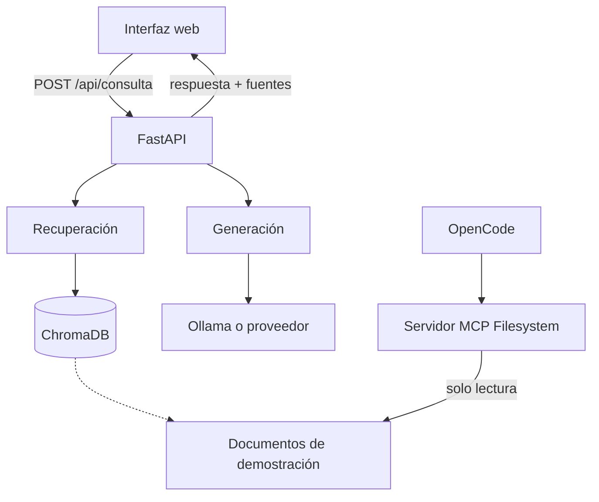

# Arquitectura — TecBot Académico

> **Documento de demostración del curso.** Describe un prototipo didáctico, no una infraestructura institucional.

## 1. Vista general



## 2. Componentes

| Componente | Responsabilidad |
|---|---|
| Interfaz | Formular la pregunta y mostrar respuesta, fuentes y estados |
| API | Validar, orquestar y devolver el contrato |
| Recuperación | Buscar fragmentos y devolver metadatos |
| ChromaDB | Almacenar embeddings y metadatos |
| Generación | Redactar con base en el contexto |
| MCP Filesystem | Permitir al agente de desarrollo leer documentos |

## 3. Tecnologías

- Python 3.11+
- FastAPI + Uvicorn
- Pydantic
- ChromaDB
- Ollama o proveedor compatible
- OpenCode
- Git y GitHub
- Frontend estático o React

## 4. Estructura

```text
tecbot-academico/
├── app/
│   ├── main.py
│   ├── schemas.py
│   ├── rag.py
│   ├── generation.py
│   └── config.py
├── documentos-demo/
├── documentacion/
├── prompts/
├── scripts/
│   ├── indexar.py
│   └── consultar.py
├── tests/
├── frontend/
├── AGENTS.md
├── opencode.json
├── requirements.txt
└── README.md
```

## 5. Contrato de la API

`POST /api/consulta`

```json
{
  "pregunta": "¿Qué necesito para el servicio social?"
}
```

Respuesta:

```json
{
  "respuesta": "Para iniciar el servicio social...",
  "fuentes": [
    {
      "documento": "servicio-social.md",
      "tema": "servicio-social",
      "fragmento": "Texto recuperado..."
    }
  ],
  "advertencia": null
}
```

Sin evidencia:

```json
{
  "respuesta": "No encontré información suficiente en los documentos disponibles.",
  "fuentes": [],
  "advertencia": "Acude al departamento correspondiente para confirmar."
}
```

## 6. Flujo de consulta

1. La interfaz valida y envía la pregunta.
2. La API valida con Pydantic.
3. La recuperación consulta ChromaDB con `n_results=4`.
4. Si no hay evidencia suficiente, responde con abstención.
5. Si hay evidencia, construye el contexto y llama al modelo.
6. Devuelve respuesta, fuentes y advertencia.
7. La interfaz muestra los estados correspondientes.

## 7. Configuración de OpenCode

```json
{
  "$schema": "https://opencode.ai/config.json",
  "instructions": ["AGENTS.md"],
  "agent": {
    "arquitecto": {
      "description": "Analiza y propone arquitectura sin modificar archivos.",
      "mode": "subagent",
      "prompt": "{file:./prompts/arquitecto.md}",
      "permission": { "edit": "deny", "bash": "deny" }
    },
    "desarrollador": {
      "description": "Implementa funcionalidades aprobadas y pruebas.",
      "mode": "subagent",
      "prompt": "{file:./prompts/desarrollador.md}",
      "permission": { "edit": "allow", "bash": "ask" }
    },
    "tester": {
      "description": "Ejecuta pruebas y reporta fallos sin editar.",
      "mode": "subagent",
      "prompt": "{file:./prompts/tester.md}",
      "permission": {
        "edit": "deny",
        "bash": {
          "*": "deny",
          "pytest *": "allow",
          "python -m pytest *": "allow"
        }
      }
    }
  }
}
```

## 8. Decisiones

| Decisión | Motivo | Alternativa descartada |
|---|---|---|
| FastAPI | Validación y pruebas simples | Flask por menor tipado |
| ChromaDB | Local y sin servidor externo | Base vectorial administrada |
| RAG | Actualizar sin reentrenar y citar fuentes | Fine-tuning |
| Documentos demo | Evitar inventar normativa | Documentos reales sin autorización |
| MCP solo en desarrollo | La app no requiere acceso de agente | Exponer archivos al frontend |

## 9. Seguridad

- Sin datos personales.
- `.env` fuera de Git.
- CORS restringido.
- MCP limitado a `documentos-demo/`.
- Escritura MCP denegada.
- Validación de entrada.
- Errores sin trazas internas.

## 10. Relación con el portal

El portal del curso es un sitio estático separado. No implementa esta arquitectura; solo la documenta. TecBot Académico se ejecuta en su propio repositorio.
