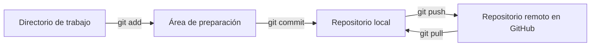
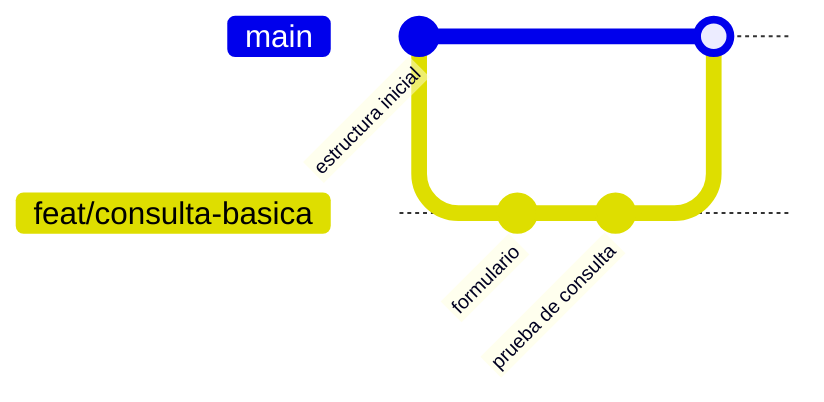

> **Objetivo de aprendizaje:** inicializar un repositorio local, registrar cambios con commits claros, conectarlo a GitHub y publicar la primera versión del proyecto sin exponer credenciales.

## Por qué usar control de versiones desde el día 1

Un agente puede generar muchos cambios en pocos minutos. Git te permite:

- Volver a una versión que funcionaba.
- Revisar qué cambió y por qué.
- Separar experimentos de la rama principal.
- Colaborar sin sobrescribir el trabajo de otra persona.
- Demostrar la evolución del proyecto.

> **Regla del curso:** ningún cambio importante se queda solo en la carpeta local. Se prueba, se registra y se publica.

## Modelo mental de Git



- **Directorio de trabajo:** los archivos que editas.
- **Staging:** los cambios que incluirás en el próximo commit.
- **Repositorio local:** el historial guardado en `.git`.
- **Remoto:** la copia en GitHub.

## Paso 1. Verificar la identidad

```bash
git --version
git config --global user.name "Tu Nombre"
git config --global user.email "tu-correo@ejemplo.com"
```

Usa el correo asociado a tu cuenta de GitHub si quieres que los commits se vinculen correctamente.

## Paso 2. Inicializar el proyecto

Desde la carpeta del proyecto:

```bash
git init
git status
```

Crea un `.gitignore` antes del primer commit:

```gitignore
# Python
__pycache__/
*.py[cod]
.venv/
venv/
.env
.env.*

# Node
node_modules/
dist/

# Herramientas
.vscode/
.idea/
.DS_Store

# Datos locales
chroma_db/
*.sqlite3
```

> **Importante:** si un archivo ya fue registrado en Git, agregarlo a `.gitignore` no lo elimina del historial. Usa `git rm --cached archivo` y revisa que no contenga secretos.

## Paso 3. Crear el primer commit

```bash
git add README.md AGENTS.md .gitignore opencode.json
git status
git commit -m "chore: estructura inicial del proyecto"
```

Un buen mensaje de commit describe el cambio, no la actividad:

| Evita | Prefiere |
|---|---|
| `cambios` | `docs: agrega criterios de aceptación` |
| `arreglos` | `fix: valida pregunta vacía en /api/consulta` |
| `avance` | `feat: agrega recuperación de documentos con ChromaDB` |

Convención simple:

- `feat:` nueva funcionalidad.
- `fix:` corrección de error.
- `docs:` documentación.
- `test:` pruebas.
- `refactor:` cambio interno sin alterar comportamiento.
- `chore:` mantenimiento o configuración.

## Paso 4. Crear el repositorio en GitHub

1. Entra a [github.com](https://github.com) e inicia sesión.
2. Selecciona **New repository**.
3. Nombre sugerido: `tecbot-academico`.
4. No marques “Add a README” si ya tienes archivos locales.
5. Crea el repositorio y copia la URL.

Conecta el remoto:

```bash
git branch -M main
git remote add origin https://github.com/TU-USUARIO/tecbot-academico.git
git remote -v
```

Publica:

```bash
git push -u origin main
```

Sustituye `TU-USUARIO` por tu nombre de usuario real. No inventes una URL.

## Paso 5. Verificar en GitHub

En la página del repositorio comprueba:

- La rama `main` existe.
- El `README.md` se muestra correctamente.
- `AGENTS.md` está versionado.
- `.env` y `node_modules` no aparecen.
- El commit tiene un mensaje claro.

## Autenticación sin exponer secretos

GitHub ya no acepta contraseñas para operaciones Git. Usa una de estas opciones:

### Git Credential Manager

En Windows suele instalarse con Git. La primera vez que hagas `push`, se abrirá una ventana del navegador para autenticar.

### Token de acceso personal

Si usas un token, actúa como contraseña en el prompt. **Nunca** lo escribas en un archivo del repositorio ni lo incluyas en la URL del remoto.

### SSH

```bash
ssh-keygen -t ed25519 -C "tu-correo@ejemplo.com"
```

Agrega la clave pública en GitHub → **Settings** → **SSH and GPG keys**. La clave privada se queda en tu equipo.

> **Nunca subas a Git:** claves de API, tokens, archivos `.env`, bases de datos con datos personales ni credenciales institucionales.

## Trabajar con ramas

Para cambios pequeños puedes trabajar en `main`, pero desde el día 1 conviene practicar ramas:

```bash
git switch -c feat/consulta-basica
# realiza cambios
git add .
git commit -m "feat: agrega formulario de consulta"
git push -u origin feat/consulta-basica
```

En GitHub abre un **Pull Request**. Revisa el diff, ejecuta las pruebas y fusiona cuando esté listo.



## README mínimo del proyecto

````markdown
# TecBot Académico

Asistente de información académica desarrollado durante el curso
"Creación de software con Agentes de IA".

## Requisitos
- Python 3.11+
- Node.js 20+ (si aplica)
- OpenCode

## Ejecución local
```bash
python -m venv .venv
source .venv/bin/activate  # Windows: .venv\Scripts\activate
pip install -r requirements.txt
uvicorn app.main:app --reload
```

## Estado
Prototipo académico. Los documentos incluidos son de demostración.
````

Ajusta los comandos a tu sistema y a las herramientas que realmente uses.

## Actividad de práctica

1. Inicializa Git en tu proyecto.
2. Crea `.gitignore` y confirma que `.env` no se versiona.
3. Haz un commit por cada bloque lógico: estructura, documentación, primera funcionalidad.
4. Publica el repositorio en GitHub.
5. Crea una rama, agrega una mejora pequeña y abre un Pull Request.
6. Comparte la URL del repositorio con el equipo.

**Resultado esperado:** repositorio público o privado con historial legible, README funcional y sin secretos.

## Problemas frecuentes

**`remote origin already exists`.**  
Revisa el remoto actual con `git remote -v`. Si es incorrecto, usa `git remote set-url origin <url>`.

**`rejected — non-fast-forward`.**  
El remoto tiene cambios que no tienes. Ejecuta `git pull --rebase origin main`, resuelve conflictos y vuelve a intentar.

**Se subió un archivo `.env`.**  
Elimínalo del seguimiento con `git rm --cached .env`, agrégalo a `.gitignore`, haz commit y **rota las credenciales** si eran reales. Borrar el archivo no borra el historial.

**El commit incluye `node_modules` o `.venv`.**  
Agrega la carpeta a `.gitignore`, elimina del índice con `git rm -r --cached node_modules` y vuelve a hacer commit.

## Recursos complementarios

- [Documentación de Git](https://git-scm.com/doc)
- [GitHub Docs](https://docs.github.com/es)
- [Acerca de los tokens de acceso personal](https://docs.github.com/es/authentication/keeping-your-account-and-data-secure/managing-your-personal-access-tokens)
- [Plantilla AGENTS.md](/descargas/AGENTS.md)

**Siguiente paso:** el [Día 2](/dias/dia-2) convierte esta base en un flujo de construcción con agentes y subagentes.
