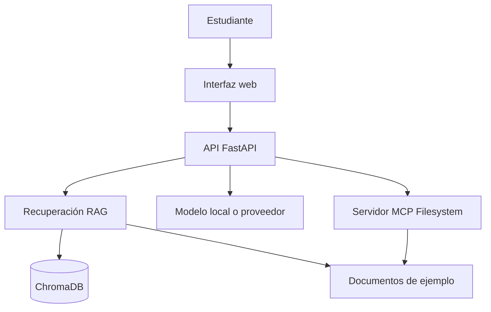

> **Objetivo de aprendizaje:** transformar una necesidad expresada en lenguaje cotidiano en un conjunto de requerimientos, historias de usuario y criterios de aceptación que un equipo —humano o agente— pueda implementar y verificar.

## El problema antes que la solución

Un agente puede escribir código muy rápido. Si el problema está mal definido, lo hará rápido en la dirección equivocada. La ingeniería de requerimientos reduce esa ambigüedad.

Para el curso usaremos una regla sencilla:

> **Un requerimiento es útil si otra persona puede decir “cumplido” o “no cumplido” sin preguntarte qué quisiste decir.**

## Paso 1. Definir el problema

Escribe el problema sin mencionar la solución. Este es un ejemplo para TecBot Académico:

```markdown
## Problema

Los estudiantes del tecnológico necesitan consultar requisitos y procedimientos
de servicio social, residencias, titulación y acreditación. La información está
dispersa en documentos y cada estudiante debe buscar en varios lugares.

## Evidencia

- Consultas repetidas al departamento académico.
- Documentos con nombres distintos en diferentes carpetas.
- Respuestas inconsistentes cuando no se cita la fuente.

## Consecuencia

Los estudiantes pierden tiempo, entregan documentos incompletos o inician
trámites con información desactualizada.

## Lo que NO se resolverá en este curso

- Validar trámites reales.
- Sustituir la atención oficial del departamento.
- Automatizar firmas o pagos.
```

Este último bloque es tan importante como el problema: delimita el alcance.

## Paso 2. Identificar usuarios y necesidades

No todos los usuarios necesitan lo mismo. Para TecBot Académico:

| Usuario | Necesidad principal | Qué valor le entrega el asistente |
|---|---|---|
| Estudiante de nuevo ingreso | Saber qué trámites existen y cuándo hacerlos | Orientación inicial y enlaces |
| Estudiante de semestres avanzados | Iniciar servicio social o residencias | Requisitos y pasos ordenados |
| Egresado | Conocer modalidades y etapas de titulación | Checklist y formatos |
| Personal de apoyo | Reducir consultas repetitivas | Respuestas consistentes con fuente |
| Docente | Canalizar dudas sin improvisar | Derivación al área correcta |

Para cada usuario, identifica además:

- Qué sabe antes de usar el sistema.
- Qué decisión quiere tomar.
- Qué evidencia necesita para confiar en la respuesta.
- Qué pasa si el asistente no sabe.

## Paso 3. Separar requerimientos funcionales y no funcionales

### Requerimientos funcionales

Describen **qué hace** el sistema. Deben tener un sujeto, una acción y un resultado observable.

| ID | Requerimiento funcional |
|---|---|
| RF-01 | El sistema debe recibir una pregunta escrita en lenguaje natural. |
| RF-02 | El sistema debe identificar el tema de la consulta entre servicio social, residencias, titulación, acreditación y trámites generales. |
| RF-03 | El sistema debe recuperar fragmentos de los documentos de demostración antes de responder. |
| RF-04 | La respuesta debe mostrar al menos una fuente documental utilizada. |
| RF-05 | Si no hay evidencia suficiente, el sistema debe indicar que no cuenta con información y sugerir acudir al departamento correspondiente. |
| RF-06 | El sistema debe permitir consultar el historial de la conversación durante la sesión. |

### Requerimientos no funcionales

Describen **cómo se comporta** el sistema. Suelen ser los más olvidados y los que más afectan la experiencia.

| ID | Requerimiento no funcional | Criterio verificable |
|---|---|---|
| RNF-01 | Tiempo de respuesta | Menos de 8 segundos para una consulta en el equipo de demostración. |
| RNF-02 | Privacidad | No se envían documentos institucionales reales a servicios externos. |
| RNF-03 | Trazabilidad | Cada respuesta fundamentada incluye el nombre del documento fuente. |
| RNF-04 | Usabilidad | La interfaz funciona en pantallas de 360 px de ancho. |
| RNF-05 | Mantenibilidad | Los documentos se pueden actualizar sin modificar el código de la interfaz. |
| RNF-06 | Honestidad | El sistema no inventa fechas, requisitos ni enlaces. |
| RNF-07 | Portabilidad | La aplicación se ejecuta localmente con instrucciones documentadas. |

> **Cuidado:** “debe ser rápido”, “debe ser fácil” o “debe ser seguro” no son criterios verificables. Agrega una métrica o una condición observable.

## Paso 4. Escribir historias de usuario

Una historia de usuario describe una necesidad desde la perspectiva de una persona:

```text
Como [tipo de usuario],
quiero [acción o capacidad],
para [beneficio o decisión que puedo tomar].
```

Ejemplos para TecBot Académico:

- **HU-01.** Como estudiante de octavo semestre, quiero conocer los requisitos para iniciar mi servicio social, para planear mi carga académica con anticipación.
- **HU-02.** Como egresado, quiero comparar las modalidades de titulación, para elegir la que se ajuste a mi situación.
- **HU-03.** Como estudiante, quiero ver los documentos que respaldan una respuesta, para verificar la información antes de iniciar un trámite.
- **HU-04.** Como integrante del departamento académico, quiero que el asistente derive al área correcta cuando no tenga información, para evitar respuestas inventadas.

Cada historia debe ser pequeña. Si una historia necesita tres pantallas y dos servicios, probablemente sea una épica y deba dividirse.

## Paso 5. Definir criterios de aceptación

Los criterios convierten la historia en una prueba. Puedes usar el formato **Dado / Cuando / Entonces**:

```text
HU-01 — Requisitos de servicio social

Dado que el estudiante pregunta "¿qué necesito para iniciar el servicio social?",
cuando el asistente consulta los documentos disponibles,
entonces responde con los requisitos encontrados
y muestra al menos el documento "servicio-social.md" como fuente.

Dado que los documentos no contienen información sobre el tema,
cuando el estudiante realiza la consulta,
entonces el asistente indica que no encontró información suficiente
y recomienda acudir al departamento correspondiente.

Dado que la respuesta incluye requisitos,
cuando se muestra en pantalla,
entonces cada requisito conserva el sentido del documento original
y no se agregan fechas ni montos que no aparezcan en la fuente.
```

Un buen criterio de aceptación es:

- Observable por alguien externo.
- Independiente de la implementación.
- Positivo y negativo: incluye qué pasa cuando algo falla.
- Verificable con una prueba manual o automatizada.

## Paso 6. Esbozar la arquitectura inicial

No necesitas construir toda la arquitectura el primer día, pero sí identificar las piezas y sus responsabilidades.



| Componente | Responsabilidad | No debe hacer |
|---|---|---|
| Interfaz web | Recibir pregunta y mostrar respuesta y fuentes | Inventar requisitos |
| API FastAPI | Orquestar consulta, recuperación y respuesta | Almacenar datos personales |
| RAG | Recuperar fragmentos relevantes | Responder sin evidencia |
| ChromaDB | Guardar embeddings y metadatos | Ser la fuente de verdad editorial |
| MCP Filesystem | Dar acceso controlado a documentos | Exponer todo el disco |
| Modelo | Redactar una respuesta clara | Decidir normas institucionales |

En el Día 3 profundizaremos en RAG y MCP. Por ahora basta con saber qué pieza cumple cada función.

## Plantilla para trabajar

Descarga y completa la plantilla del curso:

- [Plantilla de requerimientos](/descargas/plantilla-requerimientos.md)
- [Ejemplo de historias de usuario](/descargas/historias-usuario.md)

Estructura mínima del documento:

```markdown
# Requerimientos — [nombre del proyecto]

## 1. Problema
## 2. Usuarios
## 3. Alcance
## 4. Requerimientos funcionales
## 5. Requerimientos no funcionales
## 6. Historias de usuario
## 7. Criterios de aceptación
## 8. Supuestos y riesgos
## 9. Fuera de alcance
```

## Actividad de práctica

En equipo:

1. Completen la plantilla para su proyecto integrador o para TecBot Académico.
2. Escriban **cinco** requerimientos funcionales con identificador.
3. Escriban **tres** requerimientos no funcionales con criterio medible.
4. Redacten **tres** historias de usuario y al menos **dos** criterios de aceptación por historia.
5. Revisen que un compañero de otro equipo pueda verificar cada criterio sin preguntar nada.

**Resultado esperado:** un documento de una o dos páginas que permita planear el desarrollo y diseñar pruebas.

## Problemas frecuentes

**Requerimientos que describen la solución.**  
“Usar React y ChromaDB” es una decisión técnica, no un requerimiento. El requerimiento es “mostrar la fuente de cada respuesta”.

**Historias gigantes.**  
Si la historia no cabe en un día de trabajo, divídela por flujo o por tipo de usuario.

**Criterios que dependen de la interpretación.**  
“Respuesta clara” no es verificable. “La respuesta incluye los tres pasos del documento y cita su fuente” sí lo es.

**Documentos inventados como si fueran oficiales.**  
Durante el curso usaremos documentos de demostración marcados como material didáctico. En un proyecto real, la fuente debe ser validada por el área responsable.

## Recursos complementarios

- [Plantilla de requerimientos](/descargas/plantilla-requerimientos.md)
- [Ejemplo de arquitectura Mermaid](/descargas/arquitectura.mmd)
- [GitHub Docs: acerca de los repositorios](https://docs.github.com/es/repositories)

**Siguiente paso:** aprender a trabajar con el agente en [Primeros pasos con OpenCode](/dias/dia-1/opencode).
