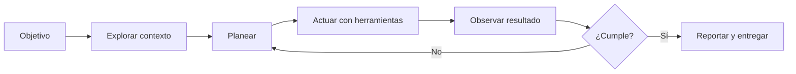

> **Objetivo de aprendizaje:** distinguir qué es un agente de desarrollo, qué puede hacer dentro de un proyecto real y cuáles son sus límites. Al terminar, podrás explicar el ciclo de trabajo de un agente y decidir en qué tareas conviene usarlo.

## Por qué empezar aquí

Durante años, programar con asistencia de IA significó pedir fragmentos de código y pegarlos en un editor. Un **agente de desarrollo** cambia la unidad de trabajo: ya no pides una función aislada, sino que delegas un objetivo dentro de un repositorio.

El agente puede leer archivos, buscar en el proyecto, ejecutar comandos, proponer cambios, aplicarlos y comprobar el resultado. Tú sigues siendo responsable de lo que se construye.

> **Idea central:** un agente no sustituye al equipo de desarrollo. Amplifica su capacidad de explorar, implementar y verificar, siempre que reciba contexto y límites claros.

## Qué es un agente de desarrollo

Un agente de IA es un sistema que recibe un objetivo, decide una secuencia de acciones y usa herramientas para acercarse al resultado. En desarrollo de software, esas herramientas suelen ser:

- Leer y escribir archivos.
- Buscar texto o patrones en el repositorio.
- Ejecutar comandos de terminal y pruebas.
- Consultar documentación o servicios externos.
- Pedir aclaraciones antes de tomar una decisión.

El comportamiento se repite en un bucle:



La diferencia con una respuesta de chat es que el agente **observa el efecto de sus acciones**. Si una prueba falla, puede leer el error y corregir. Si un archivo no existe, puede buscarlo. Ese ciclo de retroalimentación es lo que lo vuelve útil para tareas de varios pasos.

## Chatbot tradicional vs. agente de desarrollo

| Aspecto | Chatbot tradicional | Agente de desarrollo |
|---|---|---|
| Entrada | Una pregunta | Un objetivo dentro de un proyecto |
| Contexto | Lo que pegaste en el chat | Archivos, reglas, historial y comandos |
| Acciones | Devuelve texto | Lee, edita, ejecuta y verifica |
| Iteración | Tú copias y pruebas | El agente prueba y corrige |
| Riesgo principal | Respuesta incorrecta | Cambios amplios o comandos peligrosos |
| Control | Copiar o descartar | Permisos, revisión de diffs y pruebas |

Un chatbot puede explicarte qué es una prueba unitaria. Un agente puede crear el archivo de pruebas, ejecutarlo, leer el fallo y ajustar la implementación. La segunda opción requiere más supervisión, no menos.

## Qué puede hacer un agente de programación

En un proyecto bien preparado, un agente puede:

1. **Explorar** un repositorio y explicar su estructura.
2. **Planear** una funcionalidad antes de tocar código.
3. **Implementar** cambios en varios archivos.
4. **Ejecutar** pruebas, linters o el servidor de desarrollo.
5. **Revisar** sus propios cambios y proponer correcciones.
6. **Documentar** lo que hizo y qué quedó pendiente.

También hay tareas donde rinde menos o requiere más cuidado:

- Decisiones de producto sin contexto de negocio.
- Cambios masivos sin pruebas automatizadas.
- Configuración de credenciales o infraestructura sensible.
- Requisitos institucionales que no están documentados.
- Problemas que dependen de una persona o de una norma externa.

> **Regla de oro:** si no puedes verificar el resultado, no delegues la decisión completa. Pide un plan, revisa el diff y ejecuta las pruebas.

## Herramientas de desarrollo agéntico

El ecosistema cambia rápido. Las categorías que conviene reconocer son:

- **Agentes de terminal:** trabajan directamente en la carpeta del proyecto. OpenCode es el que usaremos en el curso.
- **Editores con agentes integrados:** incorporan el agente dentro del IDE.
- **Agentes en la nube:** trabajan sobre una copia del repositorio y entregan cambios mediante pull requests.
- **Herramientas de revisión:** analizan cambios, seguridad o calidad sin modificar archivos.

No necesitas dominar todas. Para este curso utilizaremos **OpenCode** porque es abierto, funciona en terminal y permite configurar agentes, permisos y servidores MCP.

## Cómo cambia el trabajo del equipo

El flujo tradicional suele ser: analizar → diseñar → implementar → probar. Con agentes, el equipo puede paralelizar partes del ciclo, pero aparecen nuevas responsabilidades:

| Antes | Con agentes |
|---|---|
| Escribir cada línea | Definir contexto y criterios de éxito |
| Buscar archivos manualmente | Verificar que el agente leyó los correctos |
| Probar al final | Diseñar pruebas desde el inicio |
| Revisar código propio | Revisar cambios generados con más rigor |
| Documentar de memoria | Mantener AGENTS.md y decisiones actualizadas |

El cuello de botella se mueve: ya no es escribir código, sino **definir bien el problema, dar contexto y validar resultados**.

## Un ejemplo aplicado al curso

El proyecto conductor es **TecBot Académico**, un asistente de información académica. Un agente podría recibir este objetivo:

```text
Implementa una ruta /api/consulta que reciba una pregunta,
busque fragmentos en la colección "documentos_academicos"
y devuelva una respuesta con las fuentes utilizadas.
Antes de escribir código, propón el plan y los casos de prueba.
```

Observa que el objetivo incluye:

- Una acción concreta.
- El punto de entrada.
- La fuente de conocimiento.
- El formato de salida.
- Una restricción de proceso: planear antes de implementar.

Ese nivel de detalle es el que separa una petición vaga de una tarea delegable.

## Actividad de práctica

En equipos de dos o tres personas:

1. Elijan una tarea cotidiana del tecnológico que implique consultar información.
2. Escriban en una hoja tres columnas: **entrada**, **acciones del agente** y **resultado verificable**.
3. Identifiquen una acción que el agente **no** debería ejecutar sin autorización.
4. Compartan un ejemplo y expliquen cómo comprobarían que la respuesta es correcta.

**Resultado esperado:** una descripción de una tarea delegable con un criterio de verificación claro, no una lista de deseos.

## Conceptos clave para recordar

- **Agente:** modelo + herramientas + ciclo de acción y observación.
- **Contexto:** información que el agente necesita para decidir bien.
- **Herramienta:** capacidad concreta, como leer un archivo o ejecutar una prueba.
- **Permiso:** límite explícito sobre lo que el agente puede hacer.
- **Verificación:** evidencia de que el resultado cumple el objetivo.

## Problemas frecuentes

**“El agente cambió demasiados archivos.”**  
Falta acotar el alcance y revisar el plan. Divide la tarea y pide cambios pequeños.

**“Inventó una función que no existe.”**  
Probablemente no tenía acceso al archivo correcto o no se le indicó la API real. Usa referencias explícitas con `@archivo` y pide que lea antes de escribir.

**“La respuesta suena bien, pero no funciona.”**  
Una respuesta plausible no es evidencia. Ejecuta pruebas y revisa el diff.

## Recursos complementarios

- [Documentación oficial de OpenCode](https://opencode.ai/docs/)
- [Guía de introducción de OpenCode](https://opencode.ai/docs/)
- [GitHub Docs](https://docs.github.com/)

**Siguiente paso:** convertir una necesidad en requerimientos verificables en [De la idea a los requerimientos](/dias/dia-1/ingenieria-requerimientos).
