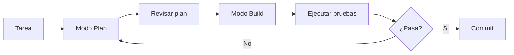

> **Objetivo de aprendizaje:** instalar OpenCode, inicializar un proyecto, comprender sus modos de trabajo y realizar la primera sesión guiada con un agente. Al terminar, podrás pedir a un agente que explore, planee y modifique un repositorio pequeño con supervisión.

## Objetivo

Aprender a instalar y usar OpenCode como agente de desarrollo en terminal, inicializar el contexto del proyecto y ejecutar un primer flujo Plan → Build → Verificar.

## Resultado esperado

Al finalizar esta actividad tendrás OpenCode instalado, un proyecto inicializado con `AGENTS.md` y una primera modificación verificada mediante pruebas o ejecución.

## Requisitos previos

- Sistema operativo: Windows 10/11 con PowerShell.
- Node.js 20 o superior instalado (`node --version`).
- Git instalado (`git --version`).
- Cuenta en un proveedor de modelos (OpenAI, Anthropic, Google, etc.) o modelo local (Ollama).
- Conexión a internet para la instalación.

## Conceptos fundamentales

- **OpenCode** es un agente de desarrollo que se ejecuta en la terminal y trabaja sobre la carpeta del proyecto.
- **`/init`** analiza el repositorio y genera un archivo `AGENTS.md` con contexto inicial.
- **AGENTS.md** es el documento permanente de reglas, arquitectura y convenciones del proyecto.
- **Modo Plan:** el agente propone un plan sin modificar archivos.
- **Modo Build:** el agente ejecuta el plan y modifica archivos.
- **Herramientas:** capacidades concretas (leer, escribir, buscar, ejecutar comandos).
- **Permisos:** límites explícitos sobre qué puede hacer el agente.

## Paso 1. Preparar el entorno (Windows / PowerShell)

Abre PowerShell y verifica las herramientas:

```powershell
node --version
git --version
```

Crea una carpeta de trabajo y un proyecto mínimo:

```powershell
mkdir C:\proyectos\tecbot-academico
cd C:\proyectos\tecbot-academico
git init
```

Crea un archivo inicial:

```powershell
@"
# TecBot Académico

Proyecto de ejemplo para el curso.
"@ | Out-File -Encoding utf8 README.md
```

## Paso 2. Instalar OpenCode

Sigue la documentación oficial de OpenCode para tu plataforma. En Windows, la forma más común es mediante npm:

```powershell
npm install -g opencode-ai
```

Verifica la instalación:

```powershell
opencode --version
```

> **Nota de versión:** OpenCode se actualiza con frecuencia. Si el comando o el paquete cambian, consulta https://opencode.ai/docs/ y ajusta. No inventes flags ni parámetros no documentados.

Configura tu proveedor de modelos. OpenCode solicita la clave al primer uso o mediante variables de entorno. Ejemplo con OpenAI:

```powershell
$env:OPENAI_API_KEY = "tu-clave-aqui"
```

Para persistirla en tu perfil de PowerShell (opcional):

```powershell
[Environment]::SetEnvironmentVariable("OPENAI_API_KEY", "tu-clave-aqui", "User")
```

## Paso 3. Inicializar el proyecto

Entra a la carpeta del proyecto y ejecuta OpenCode:

```powershell
cd C:\proyectos\tecbot-academico
opencode
```

Dentro de OpenCode, inicializa el contexto:

```text
/init
```

Esto analiza el repositorio y genera `AGENTS.md`. Revisa el archivo generado y ajústalo: agrega reglas, stack tecnológico, comandos y convenciones.

## Paso 4. Entender los modos de trabajo

OpenCode distingue al menos dos modos:

- **Plan:** el agente propone un plan y no modifica archivos. Úsalo antes de cualquier cambio.
- **Build:** el agente ejecuta el plan y modifica archivos.

Flujo recomendado:



## Paso 5. Primera sesión guiada

Pide al agente un plan (modo Plan):

```text
Analiza el repositorio. Propón una estructura mínima para un proyecto FastAPI + React.
No modifiques archivos. Devuelve la estructura de carpetas y los archivos iniciales.
```

Revisa el plan. Si te convence, cambia a modo Build y pide la implementación:

```text
Implementa la estructura propuesta. Crea solo los archivos indicados en el plan.
No agregues dependencias no justificadas. Al terminar, muestra el diff.
```

## Paso 6. Verificar

Ejecuta las pruebas o el servidor:

```powershell
# Backend (si se creó)
python -m uvicorn main:app --reload
```

En otra terminal, verifica el endpoint:

```powershell
curl http://localhost:8000/salud
```

## Paso 7. Errores frecuentes

- **OpenCode no encuentra el proyecto:** asegúrate de ejecutarlo dentro de la carpeta del proyecto.
- **Clave de API inválida:** verifica la variable de entorno y que el proveedor esté configurado.
- **El agente modifica demasiados archivos:** acota el alcance en el prompt y usa modo Plan primero.
- **Cambios no deseados:** revisa el diff antes de hacer commit; usa `git diff`.

## Paso 8. Entregable

- OpenCode instalado y funcionando.
- Proyecto inicializado con `AGENTS.md`.
- Primera modificación verificada.

## Paso 9. Criterios de aceptación

- `opencode --version` devuelve una versión.
- Existe `AGENTS.md` en la raíz del proyecto.
- Se realizó al menos un cambio verificado (prueba o ejecución exitosa).

## Prompt listo para OpenCode

```text
Contexto: repositorio vacío de TecBot Académico, proyecto FastAPI + React + TypeScript.
Objetivo: proponer una estructura mínima de carpetas y archivos iniciales.
Restricciones: no modifiques archivos; solo propón. No agregues Docker ni contenedores.
Resultado esperado: lista de carpetas y archivos con una línea de descripción cada uno.
Criterios de aceptación: la estructura separa backend/ y frontend/ y no incluye Docker.
```

## Recursos complementarios

- [Documentación oficial de OpenCode](https://opencode.ai/docs/)
- [OpenCode GitHub](https://github.com/opencode-ai/opencode)

**Siguiente paso:** definir los requerimientos en [De la idea a los requerimientos](/dias/dia-1/ingenieria-requerimientos).
