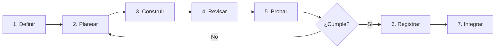

> **Objetivo de aprendizaje:** aplicar un ciclo repetible de planificación, construcción, revisión y prueba para desarrollar funcionalidades con un agente sin perder el control del repositorio.

## El problema de improvisar

Cuando se trabaja con agentes sin método aparecen patrones conocidos:

- Se pide “haz todo el proyecto” y el agente inventa una arquitectura.
- Se aceptan cambios sin leerlos porque “parecen correctos”.
- Las pruebas se escriben al final o no se escriben.
- Cada nueva sesión olvida las decisiones anteriores.
- El repositorio se convierte en una colección de experimentos sin historial claro.

El ciclo de desarrollo agéntico reduce estos riesgos. No es exclusivo de la IA: es una forma disciplinada de trabajar con cualquier colaborador rápido.



## 1. Definir el resultado

Antes de abrir el agente, escribe el resultado observable:

```text
Funcionalidad: consulta de servicio social
Entrada: pregunta en lenguaje natural
Salida: respuesta breve + al menos una fuente documental
Caso feliz: "¿Qué requisitos hay para el servicio social?"
Caso vacío: "¿Cuál es el horario de la cafetería?"
Restricción: no inventar requisitos ni fechas
Verificación: prueba de API + revisión manual de la respuesta
```

Si no puedes describir el resultado, todavía no estás listo para delegar. Estás en la fase de definición.

## 2. Planear con el agente

Usa el modo **Plan**. Pide un plan que incluya archivos, dependencias y verificación:

```text
Objetivo: agregar una ruta POST /api/consulta que reciba {"pregunta": "..."}.

Contexto:
- La API usa FastAPI.
- Los documentos están en documentos-demo/.
- La recuperación se implementará en el Día 3; por ahora usa una búsqueda simple por palabra clave.
- No agregues autenticación ni base de datos.

Antes de escribir código:
1. Propón los archivos a modificar o crear.
2. Define el contrato de entrada y salida.
3. Enumera los casos de prueba.
4. Señala riesgos o supuestos.
```

Evalúa el plan con esta lista:

- ¿Respeta el alcance?
- ¿Reutiliza lo que ya existe?
- ¿Incluye pruebas?
- ¿Hay decisiones que no puede tomar solo?
- ¿Qué archivos tocará?

## 3. Construir en pasos pequeños

Divide el plan en incrementos verificables:

```text
Incremento 1: modelo de datos y ruta que devuelve un stub.
Incremento 2: búsqueda por palabra clave en documentos.
Incremento 3: formato de respuesta con fuentes.
Incremento 4: manejo de casos sin evidencia.
```

Pide un incremento a la vez. Después de cada uno:

```bash
git diff
pytest
```

Si el agente propone un cambio grande, responde:

```text
Detente. Implementa solo el incremento 1. No modifiques la interfaz todavía.
```

## 4. Revisar el cambio

No revises solo el resumen del agente. Revisa el código:

- ¿Se modificaron archivos inesperados?
- ¿Se agregaron dependencias sin justificación?
- ¿Los nombres respetan las convenciones del proyecto?
- ¿Hay manejo de errores?
- ¿Se expusieron datos o rutas no previstas?
- ¿Los comentarios explican decisiones o repiten el código?

Un diff pequeño es más fácil de revisar. Si el agente cambió 15 archivos para una tarea de una ruta, probablemente se excedió.

## 5. Probar con evidencia

Una prueba debe poder fallar. Si nunca falla, no está verificando nada.

| Nivel | Qué valida | Ejemplo |
|---|---|---|
| Unidad | Una función aislada | Normalizar una pregunta |
| Integración | Varias piezas juntas | Ruta + recuperación + formato |
| Contrato | Entrada y salida de la API | Código 200/422 y estructura JSON |
| Manual | Experiencia real | Pregunta en la interfaz y revisión de fuentes |
| Aceptación | Criterio del usuario | HU-01 cumple sus tres escenarios |

En el módulo de [Pruebas y validación](/dias/dia-2/pruebas) construiremos una matriz completa.

## 6. Registrar el cambio

Haz commit solo cuando el incremento esté revisado y probado:

```bash
git add app/ tests/
git commit -m "feat: agrega consulta por palabra clave con fuentes"
```

El mensaje debe explicar el resultado, no el proceso. Si el commit incluye una decisión relevante, agrégala en el cuerpo:

```text
feat: agrega consulta por palabra clave con fuentes

Se usa búsqueda simple para el Día 2. La recuperación semántica
se incorpora en el Día 3 sin cambiar el contrato de la API.
```

## 7. Integrar y actualizar contexto

Al terminar una funcionalidad:

1. Actualiza `AGENTS.md` si cambió la arquitectura o un comando.
2. Actualiza el README si cambió la forma de ejecutar.
3. Fusiona la rama mediante un Pull Request.
4. Verifica que la rama principal sigue funcionando.

## Ejemplo completo: una funcionalidad en una sesión

**Petición inicial (Plan):**

```text
Lee @AGENTS.md y @docs/requerimientos.md.
Diseña la ruta POST /api/consulta para el incremento 1.
No implementes todavía. Devuelve archivos, contrato y pruebas.
```

**Plan aprobado.** Cambias a Build:

```text
Implementa el incremento 1 exactamente como lo planeaste.
Crea app/schemas.py y una prueba en tests/test_consulta.py.
Ejecuta pytest y muestra la salida.
```

**Revisión:**

```bash
git diff
pytest -q
```

**Corrección:**

```text
La prueba no cubre una pregunta vacía. Agrega ese caso,
valida que devuelva 422 y no modifiques el resto.
```

**Cierre:**

```bash
git add .
git commit -m "feat: agrega contrato inicial de consulta académica"
```

## Señales de que el ciclo se rompió

- El agente lleva mucho tiempo sin mostrar resultados verificables.
- El plan cambió sin que lo aprobaras.
- Hay archivos nuevos que no sabes por qué existen.
- Las pruebas pasan, pero no prueban el comportamiento esperado.
- No puedes explicar el cambio sin volver a leer todo el diff.

Cuando aparezca una señal, detén la sesión, vuelve al último commit estable y reduce el alcance.

## Actividad de práctica

En parejas:

1. Elijan una funcionalidad pequeña de su proyecto.
2. Escriban el resultado observable y los casos de prueba.
3. Pidan un plan en modo Plan y critíquenlo con la lista de evaluación.
4. Implementen solo el primer incremento.
5. Revisen el diff, ejecuten pruebas y registren el commit.
6. Anoten una decisión que deba actualizarse en `AGENTS.md`.

**Resultado esperado:** una funcionalidad pequeña integrada con evidencia de plan, revisión, prueba y commit.

## Problemas frecuentes

**“El agente no sigue el plan.”**  
El plan estaba demasiado general. Convierte cada paso en un resultado verificable y recuérdale el alcance en cada mensaje.

**“Las pruebas pasan, pero la app falla.”**  
Las pruebas no cubren el flujo real. Agrega una prueba de integración y una verificación manual.

**“Perdí el hilo de la conversación.”**  
Inicia una sesión nueva con un resumen y referencia los archivos clave. El contexto debe vivir en el repositorio, no solo en el chat.

**“El cambio es demasiado grande para revisarlo.”**  
Divide. Un diff de 200 líneas es revisable; uno de 2,000 no. Pide commits más pequeños.

## Recursos complementarios

- [OpenCode: introducción](https://opencode.ai/docs/)
- [OpenCode: agentes](https://opencode.ai/docs/agents/)
- [OpenCode: permisos](https://opencode.ai/docs/permissions/)
- [Plantilla AGENTS.md](/descargas/AGENTS.md)

**Siguiente paso:** documentar el contexto permanente en [AGENTS.md](/dias/dia-2/agents-md).
