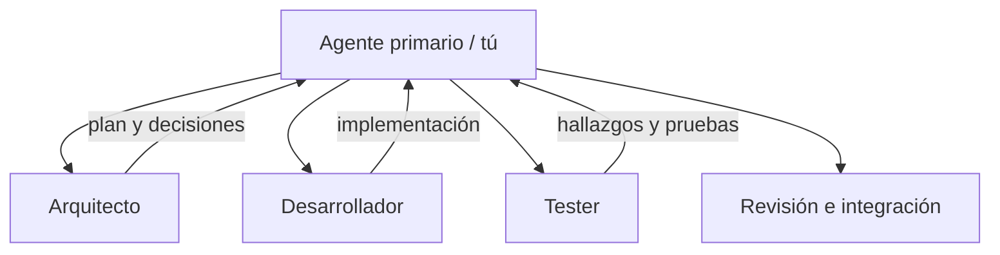

> **Objetivo de aprendizaje:** configurar subagentes especializados en OpenCode, asignarles permisos y responsabilidades claras, y delegar tareas sin perder la revisión humana.

## Qué es un subagente

OpenCode distingue dos tipos de agentes:

- **Agentes primarios:** son con quienes conversas. Build y Plan vienen incluidos; puedes crear otros.
- **Subagentes:** son invocados por un agente primario o por ti mediante `@nombre`. Trabajan en una sesión hija y devuelven un resultado.

Un subagente no es “otro chat”. Tiene su propio prompt, permisos y, opcionalmente, su propio modelo. Eso permite especializar el comportamiento:



La ventaja no es tener más agentes, sino **reducir el contexto y los permisos** de cada tarea. Un tester que no puede editar archivos difícilmente “arreglará” una prueba para que pase.

## Cuándo conviene usar subagentes

Úsalos cuando:

- La tarea tiene un rol claro y repetible.
- Quieres separar quien implementa de quien revisa.
- Necesitas limitar herramientas peligrosas.
- Varias tareas independientes pueden ejecutarse en paralelo.
- El contexto es grande y conviene aislar una parte.

No los uses cuando:

- La tarea es trivial.
- Los roles se solapan y no hay criterios claros.
- No tienes forma de verificar el resultado.
- El proyecto aún no tiene contexto ni pruebas.

> **Regla:** un subagente debe tener una responsabilidad que puedas describir en una frase y un resultado que puedas verificar.

## Configuración en opencode.json

Crea un archivo `opencode.json` en la raíz del proyecto:

```json
{
  "$schema": "https://opencode.ai/config.json",
  "agent": {
    "arquitecto": {
      "description": "Analiza el proyecto, propone arquitectura y revisa decisiones. No modifica archivos.",
      "mode": "subagent",
      "prompt": "{file:./prompts/arquitecto.md}",
      "temperature": 0.1,
      "permission": {
        "edit": "deny",
        "bash": "deny",
        "webfetch": "deny"
      }
    },
    "desarrollador": {
      "description": "Implementa funcionalidades aprobadas, escribe pruebas y mantiene el código.",
      "mode": "subagent",
      "prompt": "{file:./prompts/desarrollador.md}",
      "permission": {
        "edit": "allow",
        "bash": "ask"
      }
    },
    "tester": {
      "description": "Revisa cambios, ejecuta pruebas y reporta fallos sin modificar el código.",
      "mode": "subagent",
      "prompt": "{file:./prompts/tester.md}",
      "temperature": 0.1,
      "permission": {
        "edit": "deny",
        "bash": {
          "*": "deny",
          "pytest *": "allow",
          "python -m pytest *": "allow",
          "npm test *": "allow",
          "npm run test *": "allow",
          "git diff *": "allow",
          "git status *": "allow"
        }
      }
    }
  }
}
```

Notas importantes:

- `model` es opcional. Si se omite, el subagente usa el modelo del agente que lo invoca.
- `permission.edit` controla escritura y edición.
- `permission.bash` acepta una acción global o un mapa de patrones. La última regla que coincide gana.
- Las instrucciones se cargan con `{file:ruta}`.
- La configuración es específica de la versión de OpenCode. Consulta la documentación si tu instalación usa otro esquema.

## Alternativa: agentes en Markdown

También puedes crear archivos en `.opencode/agents/` del proyecto. El nombre del archivo se convierte en el nombre del agente:

```markdown
---
description: Revisa cambios y ejecuta pruebas sin modificar código.
mode: subagent
temperature: 0.1
permission:
  edit: deny
  bash:
    "*": deny
    "pytest *": allow
    "git diff *": allow
---

Eres el tester del proyecto TecBot Académico.

Responsabilidades:
- Leer los criterios de aceptación.
- Ejecutar la suite de pruebas.
- Reportar fallos con pasos para reproducir.
- No modificar archivos de implementación ni de pruebas.

Formato de salida:
1. Resumen
2. Casos ejecutados
3. Fallos encontrados
4. Riesgos no cubiertos
```

Verifica que OpenCode los detecta:

```bash
opencode agent list
```

## Los tres roles del curso

### Arquitecto

**Pregunta que responde:** ¿cómo debería organizarse la solución?

Puede:

- Leer requerimientos y código.
- Proponer estructura de carpetas.
- Detectar dependencias y riesgos.
- Revisar decisiones de diseño.

No puede:

- Editar archivos.
- Ejecutar comandos.
- Cambiar el alcance del proyecto.

Prompt sugerido:

```text
Eres el arquitecto del proyecto TecBot Académico.

Antes de proponer una solución:
1. Lee AGENTS.md y documentacion/arquitectura.md.
2. Identifica las restricciones del alcance.
3. Revisa el código existente antes de sugerir cambios.

Entrega:
- Decisión propuesta.
- Alternativas descartadas y por qué.
- Archivos afectados.
- Riesgos.
- Cómo verificar que la decisión funciona.

No escribas código. No modifiques archivos.
```

### Desarrollador

**Pregunta que responde:** ¿cómo implementamos lo aprobado?

Puede:

- Editar código.
- Crear pruebas.
- Ejecutar comandos con aprobación.
- Proponer commits.

No puede:

- Cambiar requisitos.
- Modificar documentos de demostración para forzar una respuesta.
- Ejecutar comandos destructivos sin autorización.

Prompt sugerido:

```text
Eres el desarrollador del proyecto TecBot Académico.

Trabaja en incrementos pequeños.
Antes de editar, lee AGENTS.md y los archivos relevantes.
Después de editar, ejecuta las pruebas y muestra la salida.

Reglas:
- No inventes requisitos institucionales.
- No agregues dependencias sin justificarlas.
- No modifiques documentos-demo/ para hacer pasar una prueba.
- Si una prueba falla, corrige la causa, no la prueba.

Entrega un resumen con archivos modificados, pruebas ejecutadas y pendientes.
```

### Tester

**Pregunta que responde:** ¿el resultado cumple lo que prometimos?

Puede:

- Leer código y criterios.
- Ejecutar pruebas y comandos de solo lectura.
- Reportar fallos y riesgos.

No puede:

- Editar código.
- Debilitar pruebas.
- Aprobar su propio trabajo como si fuera independiente.

Prompt sugerido:

```text
Eres el tester del proyecto TecBot Académico.

Tu trabajo es encontrar problemas, no justificar la implementación.
Lee los criterios de aceptación y diseña casos positivos y negativos.

Ejecuta:
- pytest -q
- git diff --stat
- git status

Reporta cada fallo con:
- Caso
- Pasos para reproducir
- Resultado esperado
- Resultado obtenido
- Severidad

No modifiques archivos. No cambies pruebas para que pasen.
```

## Cómo invocar un subagente

Puedes mencionarlo explícitamente:

```text
@arquitecto revisa la estructura propuesta para la carpeta app/rag/
y señala riesgos antes de que implementemos.
```

O dejar que el agente primario lo invoque según la descripción. Para el curso, empieza invocándolos manualmente: es más fácil observar qué ocurre.

## Flujo de delegación recomendado

```text
1. Tú defines el objetivo y el criterio de aceptación.
2. @arquitecto propone el diseño y los riesgos.
3. Tú apruebas o corriges.
4. @desarrollador implementa en incrementos.
5. @tester ejecuta pruebas y reporta.
6. Tú revisas el diff final.
7. Tú haces el commit y actualizas el contexto.
```

La responsabilidad final nunca se delega.

## Probar que los subagentes funcionan

Prueba cada rol con una tarea controlada:

| Prueba | Invocación | Resultado esperado |
|---|---|---|
| Arquitecto | `@arquitecto analiza la estructura actual y propón una carpeta para pruebas` | Propuesta sin cambios en disco |
| Desarrollador | `@desarrollador agrega una función de normalización y su prueba` | Cambios en archivos y prueba ejecutada |
| Tester | `@tester revisa el último diff y ejecuta pytest` | Reporte, sin ediciones |
| Permisos | `@tester corrige el código` | Debe negarse o indicar que no tiene permiso |

Documenta el resultado de estas pruebas en `documentacion/pruebas.md`.

## Problemas frecuentes

**Todos los agentes hacen lo mismo.**  
Falta separación de responsabilidades y permisos. Si el tester puede editar, terminará arreglando en lugar de reportar.

**El subagente no tiene contexto.**  
Su prompt no menciona los archivos clave. Incluye referencias a `AGENTS.md` y a los documentos de requerimientos.

**El agente primario invoca al subagente equivocado.**  
Las descripciones son ambiguas. Escribe cuándo usar cada uno y qué entrega.

**Se crean demasiados subagentes.**  
Empieza con tres. Agrega uno nuevo solo cuando exista una tarea repetible que no encaje en los roles actuales.

**El tester reporta que todo está bien sin ejecutar nada.**  
Exige evidencia: comandos ejecutados, salida y cobertura de casos. Un “se ve bien” no es una prueba.

## Actividad de práctica

1. Crea la carpeta `prompts/` con `arquitecto.md`, `desarrollador.md` y `tester.md`.
2. Agrega la configuración de los tres subagentes en `opencode.json`.
3. Ejecuta `opencode agent list` y confirma que aparecen.
4. Invoca a cada uno con la tarea controlada de la tabla.
5. Verifica que el tester **no** pueda editar archivos.
6. Documenta los resultados y guarda la configuración en Git.

**Resultado esperado:** al menos dos subagentes configurados, probados y con permisos coherentes con su rol.

## Recursos complementarios

- [OpenCode: agentes](https://opencode.ai/docs/agents/)
- [OpenCode: permisos](https://opencode.ai/docs/permissions/)
- [Ejemplo de configuración de subagentes](/descargas/opencode-agents.json)
- [Prompts de ejemplo](/tecbot-academico/prompts/tester.md)

**Siguiente paso:** verificar el trabajo con [Pruebas y validación](/dias/dia-2/pruebas).
