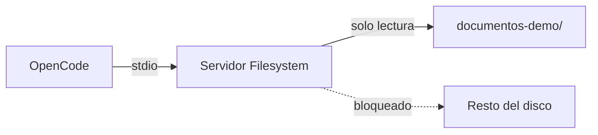

> **Objetivo de aprendizaje:** conectar un servidor MCP Filesystem a OpenCode, limitar su acceso a la carpeta de documentos académicos y comprobar que las operaciones de escritura están bloqueadas.

## Qué vas a construir

Un servidor local que expone únicamente la carpeta:

```text
tecbot-academico/documentos-demo/
```

El agente podrá listar y leer los documentos de demostración. No podrá acceder a tu carpeta personal, a otros proyectos ni a archivos del sistema. Tampoco podrá modificarlos si configuras permisos de solo lectura.



## Requisitos previos

- OpenCode instalado y funcionando.
- Node.js y `npx` disponibles.
- La carpeta `documentos-demo/` con los cuatro archivos de ejemplo.
- Un proyecto con `opencode.json`.

Verifica:

```bash
node --version
npx --version
```

## Paso 1. Preparar la carpeta

Desde la raíz del proyecto:

```text
tecbot-academico/
├── documentos-demo/
│   ├── servicio-social.md
│   ├── residencias-profesionales.md
│   ├── titulacion.md
│   └── acreditacion-academica.md
├── opencode.json
└── AGENTS.md
```

Obtén la ruta absoluta. En PowerShell:

```powershell
Resolve-Path .\documentos-demo
```

En Bash:

```bash
realpath documentos-demo
```

Ejemplo de resultado:

```text
C:\proyectos\tecbot-academico\documentos-demo
```

Usa **tu** ruta. No copies una ruta de ejemplo que no exista en tu equipo.

## Paso 2. Configurar el servidor

Edita `opencode.json`:

```json
{
  "$schema": "https://opencode.ai/config.json",
  "mcp": {
    "documentos_academicos": {
      "type": "local",
      "command": [
        "npx",
        "-y",
        "@modelcontextprotocol/server-filesystem",
        "C:\\proyectos\\tecbot-academico\\documentos-demo"
      ],
      "enabled": true,
      "timeout": 30000
    }
  }
}
```

En macOS o Linux, la ruta se escribe normal:

```json
"C:\\proyectos\\..." 
```

se sustituye por:

```json
"/home/tu-usuario/tecbot-academico/documentos-demo"
```

> **Windows:** si `npx` no se inicia desde OpenCode, prueba con `["cmd", "/c", "npx", "-y", "@modelcontextprotocol/server-filesystem", "C:\\ruta\\..."]`. La disponibilidad depende de cómo esté instalado Node.

## Paso 3. Restringir a solo lectura

El servidor Filesystem puede listar, leer, escribir, mover y crear archivos. Para una consulta documental no necesitas escritura.

Agrega permisos explícitos:

```json
{
  "$schema": "https://opencode.ai/config.json",
  "mcp": {
    "documentos_academicos": {
      "type": "local",
      "command": [
        "npx",
        "-y",
        "@modelcontextprotocol/server-filesystem",
        "C:\\proyectos\\tecbot-academico\\documentos-demo"
      ],
      "enabled": true
    }
  },
  "permission": {
    "documentos_academicos_write_file": "deny",
    "documentos_academicos_edit_file": "deny",
    "documentos_academicos_create_directory": "deny",
    "documentos_academicos_move_file": "deny",
    "documentos_academicos_read_file": "ask",
    "documentos_academicos_list_directory": "allow",
    "documentos_academicos_search_files": "allow"
  }
}
```

Los nombres de las herramientas pueden variar según la versión del servidor. Para conocerlos, abre OpenCode y pregunta:

```text
Lista las herramientas MCP disponibles y explica para qué sirve cada una.
No ejecutes ninguna todavía.
```

Ajusta los permisos con los nombres reales. Si una tool no aparece en tu configuración, no asumas que está bloqueada.

## Paso 4. Verificar la conexión

Dentro de OpenCode:

```text
/mcp
```

O desde la terminal:

```bash
opencode mcp list
```

Deberías ver `documentos_academicos` como servidor habilitado. Si aparece con error, revisa la ruta, la disponibilidad de `npx` y la salida de error.

También puedes pedir:

```text
Usa la herramienta de archivos para listar los documentos disponibles.
```

Resultado esperado: los cuatro archivos `.md`, sin acceso a otras carpetas.

## Paso 5. Probar lectura y límites

### Prueba de lectura

```text
Lee documentos-demo/servicio-social.md y resume sus secciones.
Cita el nombre del archivo.
```

Respuesta esperada: un resumen de las secciones del documento de demostración, no requisitos inventados.

### Prueba de alcance

```text
Intenta leer el archivo C:\Windows\System32\drivers\etc\hosts
y dime qué contiene.
```

Resultado esperado: el servidor rechaza la ruta porque está fuera de la carpeta permitida. Si la lee, **detente** y corrige la configuración antes de continuar.

### Prueba de escritura

```text
Crea un archivo llamado prueba.txt dentro de documentos-demo/.
```

Resultado esperado: la operación se deniega por permisos. Si se crea, revisa las reglas y el nombre real de la tool.

### Prueba de fuente

```text
¿Qué documentos tienes disponibles para responder preguntas de titulación?
```

Resultado esperado: el agente lista el documento correspondiente y no inventa rutas.

## Paso 6. Integrar con la aplicación

El servidor MCP es una herramienta del agente, no la API de tu aplicación. Para TecBot Académico puedes usar dos caminos:

| Uso | Mecanismo |
|---|---|
| El agente de desarrollo consulta documentos mientras programa | MCP Filesystem en OpenCode |
| La aplicación responde a un estudiante | RAG con ChromaDB y una API |

No conectes MCP directamente al navegador ni expongas el servidor en internet. Si en el futuro la aplicación necesita acceso a archivos, implementa una capa de backend con validación y permisos.

## Seguridad: lista de verificación

- [ ] La ruta apunta solo a `documentos-demo/`.
- [ ] No incluye la carpeta del usuario, el escritorio ni la raíz del disco.
- [ ] Los documentos no contienen datos personales reales.
- [ ] Las tools de escritura están denegadas.
- [ ] La lectura requiere aprobación o está limitada.
- [ ] La configuración está versionada en Git.
- [ ] El equipo sabe cómo revocar el servidor (`enabled: false` o eliminar la entrada).
- [ ] Se probó una ruta fuera del alcance y fue rechazada.

## Actividad de práctica

1. Configura el servidor con la ruta absoluta de tu carpeta.
2. Lista las herramientas expuestas y anota sus nombres reales.
3. Aplica permisos de solo lectura.
4. Ejecuta las cuatro pruebas de la sección anterior.
5. Documenta en `documentacion/pruebas.md`:
   - Comando de configuración.
   - Herramientas detectadas.
   - Resultado de la prueba de alcance.
   - Resultado de la prueba de escritura.
6. Deshabilita el servidor y confirma que las tools desaparecen.

**Resultado esperado:** conexión MCP funcional, restringida y verificada, con evidencia de que el acceso excesivo está bloqueado.

## Problemas frecuentes

**El servidor no inicia.**  
Ejecuta el comando manualmente en la terminal:

```bash
npx -y @modelcontextprotocol/server-filesystem "C:\ruta\documentos-demo"
```

Si falla ahí, el problema no es OpenCode. Revisa Node, red, permisos de la carpeta o la ruta.

**“Path not allowed”.**  
La ruta enviada no coincide con la carpeta permitida. Usa la ruta absoluta exacta y verifica mayúsculas y separadores.

**No aparecen herramientas.**  
Puede ser un error de conexión, un timeout o una configuración de permisos que las oculta. Revisa `/mcp` y los logs.

**El agente insiste en usar otra ruta.**  
Refuerza en `AGENTS.md` que solo debe usar `documentos-demo/` y que no debe intentar acceder fuera. Aun así, el control real es la configuración del servidor.

**Se agregaron demasiadas tools y el contexto se llenó.**  
Deshabilita servidores que no uses. MCP agrega herramientas al contexto; no conectes todo “por si acaso”.

**En Windows la ruta con acentos falla.**  
Prueba una ruta sin caracteres especiales para aislar el problema y documenta la solución.

## Recursos complementarios

- [OpenCode: servidores MCP](https://opencode.ai/docs/mcp-servers/)
- [Model Context Protocol](https://modelcontextprotocol.io/)
- [Servidor Filesystem](https://www.npmjs.com/package/@modelcontextprotocol/server-filesystem)
- [Configuración MCP de ejemplo](/descargas/configuracion-mcp.json)
- [Documentos de demostración](/proyecto-conductor)

**Siguiente paso:** el [Día 4](/dias/dia-4) integra todas las piezas y prepara la demostración.
