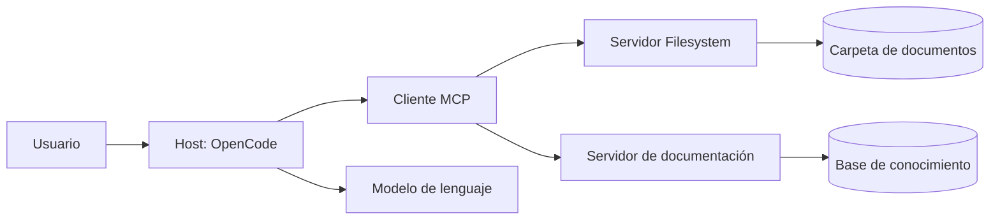

> **Objetivo de aprendizaje:** explicar qué es Model Context Protocol, cómo se relacionan host, cliente y servidor, qué aportan las tools, resources y prompts, y por qué los permisos son parte central del diseño.

## Qué es MCP

**Model Context Protocol (MCP)** es un protocolo abierto para conectar aplicaciones de IA con fuentes de datos y herramientas externas. En lugar de programar una integración distinta para cada modelo, defines un servidor con una interfaz común y cualquier host compatible puede usarlo.

Piensa en MCP como un “puerto estándar” para herramientas:

- El **host** es la aplicación donde conversas. OpenCode actúa como host.
- El **cliente** es el componente que mantiene la conexión con un servidor.
- El **servidor** expone capacidades: herramientas, recursos o prompts.



El modelo no “entra” directamente a la carpeta. El host descubre las herramientas del servidor y decide cuándo usarlas, con los permisos que hayas configurado.

## Las tres primitivas

| Primitiva | Qué representa | Ejemplo |
|---|---|---|
| **Tool** | Acción que el modelo puede ejecutar | `read_file`, `search_files`, `query_database` |
| **Resource** | Dato de solo lectura que el host puede cargar | Un documento, una configuración, un registro |
| **Prompt** | Plantilla reutilizable con instrucciones | “Resume este documento con citas” |

No todos los servidores exponen las tres. El servidor Filesystem, por ejemplo, se centra en herramientas para listar, leer y escribir archivos.

### Tools

Una tool tiene nombre, descripción y esquema de entrada. El host la presenta al modelo, que puede decidir invocarla.

```json
{
  "name": "read_file",
  "description": "Lee el contenido de un archivo de texto",
  "input": {
    "path": "documentos-demo/servicio-social.md"
  }
}
```

La descripción importa: si es ambigua, el modelo puede usar la herramienta equivocada. También importa el alcance: una tool que puede leer todo el disco es un riesgo, aunque el modelo “prometa” no salir de una carpeta.

### Resources

Un resource se identifica con una URI y se puede leer sin ejecutar una acción:

```text
file:///documentos-demo/titulacion.md
```

Son útiles para contexto que el usuario o el host quieren adjuntar explícitamente. En una aplicación educativa puedes exponer documentos como resources de solo lectura.

### Prompts

Un prompt MCP es una plantilla que el servidor ofrece al host. Puede recibir argumentos:

```text
Nombre: resumen_con_fuentes
Argumentos: documento
Plantilla: Resume el documento {documento} en cinco puntos y cita el archivo.
```

No son “prompts del sistema” ocultos. Son plantillas que el usuario puede elegir.

## Transportes

MCP puede funcionar por:

- **stdio:** el host inicia un proceso local y se comunica por entrada/salida estándar. Es el modo típico de Filesystem.
- **HTTP/SSE:** el servidor se ejecuta en red y el host se conecta por URL. Útil para servicios compartidos.

Para el curso usaremos un servidor local por `stdio`, lo que mantiene todo en el equipo y evita exponer documentos en internet.

## MCP frente a RAG

Ambos acercan conocimiento al modelo, pero lo hacen de forma distinta:

| Aspecto | RAG | MCP |
|---|---|---|
| Qué aporta | Fragmentos relevantes recuperados previamente | Acceso a herramientas y recursos en vivo |
| Cuándo se usa | Antes de generar la respuesta | Durante la conversación, cuando el modelo decide |
| Fuente | Base vectorial indexada | Servidor conectado a archivos, APIs o servicios |
| Riesgo | Recuperar fragmentos irrelevantes | Ejecutar una acción no deseada |
| Control | Umbrales, `k`, metadatos | Permisos, alcance y aprobación |

No son excluyentes. TecBot Académico puede usar RAG para responder y MCP para listar o leer documentos de una carpeta controlada.

## OpenCode como host MCP

OpenCode permite declarar servidores MCP en `opencode.json`:

```json
{
  "$schema": "https://opencode.ai/config.json",
  "mcp": {
    "documentos_academicos": {
      "type": "local",
      "command": [
        "npx",
        "-y",
        "@modelcontextprotocol/server-filesystem",
        "/ruta/absoluta/al/proyecto/documentos-demo"
      ],
      "enabled": true
    }
  }
}
```

Al iniciar, OpenCode descubre las herramientas del servidor y las registra con un prefijo. Si el servidor se llama `documentos_academicos`, herramientas como `read_file` aparecen aproximadamente como `documentos_academicos_read_file`.

Los nombres exactos dependen de la versión del servidor. Verifícalos con la lista de herramientas o preguntando al agente qué herramientas tiene disponibles.

## Permisos: el corazón del diseño

Un servidor MCP puede hacer mucho más que leer. Por eso el principio es **mínimo privilegio**:

1. Expón solo la carpeta necesaria.
2. Usa una cuenta o proceso sin permisos de administrador.
3. Niega escritura si la tarea es de consulta.
4. Pide aprobación para acciones sensibles.
5. Revisa los argumentos antes de aceptar una llamada.
6. No conectes servidores que no entiendes.
7. Registra qué herramientas usa el agente.

Ejemplo de restricción en OpenCode:

```json
{
  "$schema": "https://opencode.ai/config.json",
  "permission": {
    "documentos_academicos_write_file": "deny",
    "documentos_academicos_edit_file": "deny",
    "documentos_academicos_create_directory": "deny",
    "documentos_academicos_move_file": "deny",
    "documentos_academicos_read_file": "ask",
    "documentos_academicos_list_directory": "allow"
  }
}
```

La sintaxis exacta de los nombres puede variar; confirma las herramientas expuestas por tu servidor antes de aplicar reglas.

> **No basta con pedirle al modelo “solo lee”.** El límite debe estar en la configuración y en el sistema operativo, no en la buena voluntad del prompt.

## Cuándo usar MCP y cuándo no

**Úsalo cuando:**

- Necesitas acceder a archivos o servicios que cambian.
- Quieres separar el acceso a datos de la lógica del agente.
- Varias herramientas comparten una interfaz.
- Necesitas auditar qué acciones se ejecutan.

**Evítalo cuando:**

- Un archivo pequeño puede incluirse directamente en el contexto.
- La tarea se resuelve con una función local sencilla.
- El servidor agrega demasiadas herramientas y consume contexto.
- No puedes restringir su alcance.

## Actividad de práctica

En equipos:

1. Dibujen un host, un cliente y dos servidores MCP para TecBot Académico.
2. Para cada servidor, listen dos tools y un resource.
3. Marquen cuáles deben requerir aprobación.
4. Expliquen por qué un servidor de archivos no debería apuntar a todo el disco.
5. Comparen RAG y MCP con un ejemplo concreto del proyecto.

**Resultado esperado:** un mapa de integración con capacidades y permisos, no solo una lista de tecnologías.

## Problemas frecuentes

**“MCP le da internet al modelo.”**  
No necesariamente. Un servidor MCP expone solo las capacidades que implementa. Si no hay una tool de red, no hay acceso a red.

**“El servidor tiene muchas tools, entonces es mejor.”**  
Más herramientas consumen contexto y aumentan la ambigüedad. Prefiere servidores pequeños y enfocados.

**“El prompt dice que no escriba, así que está seguro.”**  
Un prompt no es un control de seguridad. Configura permisos y ejecuta el servidor con el mínimo acceso.

**“Conecté la carpeta del usuario y funcionó.”**  
Funcionó, pero expuso demasiado. Restringe a la carpeta del proyecto y usa solo lectura cuando sea posible.

## Recursos complementarios

- [Model Context Protocol](https://modelcontextprotocol.io/)
- [OpenCode: servidores MCP](https://opencode.ai/docs/mcp-servers/)
- [OpenCode: permisos](https://opencode.ai/docs/permissions/)
- [Servidor Filesystem en npm](https://www.npmjs.com/package/@modelcontextprotocol/server-filesystem)

**Siguiente paso:** configurar el servidor en [MCP Filesystem con acceso restringido](/dias/dia-3/filesystem).
