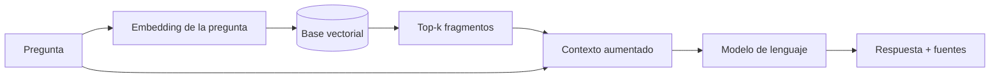

> **Objetivo de aprendizaje:** explicar el flujo de recuperación aumentada (RAG), preparar documentos para consulta y entender cómo se recuperan fragmentos relevantes antes de generar una respuesta fundamentada.

## Por qué un modelo solo no basta

Un modelo de lenguaje entrenado conoce patrones generales, pero no necesariamente:

- Los documentos internos de una institución.
- Los requisitos vigentes de un procedimiento.
- Los formatos disponibles en una carpeta compartida.
- La información que cambió después de su fecha de corte.
- La fuente exacta de una afirmación.

Si le preguntas por un trámite institucional sin darle documentos, puede responder con una mezcla plausible de información general. Ese es el problema que RAG ayuda a reducir.

> **RAG no elimina las alucinaciones.** Cambia la tarea: en lugar de “responde de memoria”, el sistema “recupera evidencia y redacta a partir de ella”. La verificación sigue siendo necesaria.

## Qué es RAG

**Retrieval-Augmented Generation** (generación aumentada por recuperación) es un patrón con tres pasos:

1. **Recuperar** fragmentos relevantes de una fuente de conocimiento.
2. **Aumentar** la pregunta del usuario con esos fragmentos como contexto.
3. **Generar** una respuesta usando únicamente ese contexto y citando las fuentes.



La base vectorial no “sabe” responder. Solo encuentra fragmentos parecidos. El modelo redacta. La calidad depende de ambas partes.

## Fases de un sistema RAG

### 1. Preparación del corpus

Antes de escribir código:

- Reúne documentos en formato legible (Markdown, texto, PDF con texto extraíble).
- Identifica el área responsable de cada documento.
- Marca claramente los documentos de demostración.
- Elimina datos personales o información sensible.
- Define metadatos: tema, título, versión, vigencia, fuente.
- Registra qué documentos **no** están disponibles.

En el curso usaremos los cuatro documentos ficticios de `tecbot-academico/documentos-demo/`. Todos están marcados como material didáctico.

### 2. Extracción

Convierte cada documento a texto limpio. Para PDFs escaneados necesitarás OCR; para tablas, conserva la estructura o conviértelas a texto explícito.

Un pipeline mínimo:

```text
documento.md → texto normalizado → fragmentos → embeddings → ChromaDB
```

### 3. Fragmentación (chunking)

Un documento completo no cabe en el contexto y además contiene información irrelevante para una pregunta. Se divide en fragmentos.

| Estrategia | Cuándo usarla | Riesgo |
|---|---|---|
| Por párrafo | Documentos con secciones claras | Fragmentos demasiado cortos |
| Por tamaño fijo | Texto sin estructura | Corta ideas a la mitad |
| Por encabezados | Markdown, manuales, reglamentos | Secciones muy largas |
| Recursiva | Mezcla de las anteriores | Requiere ajuste |
| Con solapamiento | Evitar perder contexto en los bordes | Duplica información |

Punto de partida para el curso:

- Tamaño: **600 a 900 caracteres** o 150 a 250 palabras.
- Solapamiento: **10% a 20%**.
- Conserva el encabezado de la sección en cada fragmento.
- Agrega metadatos: `documento`, `tema`, `seccion`, `chunk`, `fuente`.
- No mezcles dos temas distintos en el mismo fragmento si puedes evitarlo.

> **Prueba de calidad:** lee un fragmento aislado. ¿Se entiende sin el resto del documento? ¿Incluye el tema y la fuente? Si no, el fragmento necesita más contexto o mejores metadatos.

### 4. Embeddings

Un embedding convierte texto en un vector de números. Textos con significado parecido quedan cerca en el espacio vectorial.

```text
"requisitos para liberar el servicio social"  → [0.12, -0.04, 0.88, ...]
"documentos para concluir servicio social"    → [0.11, -0.02, 0.85, ...]
"horario de la cafetería"                     → [-0.40, 0.31, 0.09, ...]
```

La similitud se calcula con una métrica como **coseno**. No es necesario entender la matemática completa para usarlo, pero sí recordar:

- El modelo de embeddings debe ser el mismo al indexar y al consultar.
- Un cambio de modelo exige reconstruir la colección.
- Los embeddings capturan similitud semántica, no verdad.
- Pueden fallar con negaciones, siglas o vocabulario muy específico.

### 5. Base vectorial

Una base vectorial almacena vectores y metadatos, y permite buscar los más cercanos a una consulta. ChromaDB es una opción local y sencilla para el curso.

También necesitas una **fuente de verdad**: los documentos originales. La base vectorial es un índice derivado; si se corrompe, se reconstruye.

### 6. Recuperación

La consulta se convierte en embedding y se piden los `k` fragmentos más cercanos:

```text
pregunta → embedding → búsqueda top-k → filtros por metadatos → fragmentos
```

Parámetros iniciales:

- `k = 3` a `5` para respuestas breves.
- Filtro por `tema` si la pregunta es claramente de un área.
- Umbral de distancia para descartar fragmentos poco relevantes.
- Reordenamiento opcional (reranking) si hay muchos candidatos.

La recuperación no debe devolver siempre algo. Si la mejor distancia es mala, es mejor decir “no encontré información suficiente” que usar un fragmento irrelevante.

### 7. Generación fundamentada

El prompt debe obligar al modelo a trabajar con la evidencia:

```text
Eres un asistente de información académica.

Responde únicamente con la información de los FRAGMENTOS.
Si los fragmentos no contienen la respuesta, indica que no cuentas
con información suficiente y recomienda acudir al departamento correspondiente.

No inventes requisitos, fechas, montos, enlaces ni nombres de formatos.
Cita el documento de cada afirmación con el formato [documento].

PREGUNTA:
{prefijo}

FRAGMENTOS:
{contexto}
```

Una respuesta correcta debería verse así:

```text
Para iniciar el servicio social necesitas cumplir los requisitos
y entregar la documentación indicada en el documento de demostración.

1. ...
2. ...

Fuente: servicio-social.md (documento de demostración).
```

## RAG no es solo “buscar palabras”

Una búsqueda por palabra clave encuentra coincidencias exactas. La búsqueda semántica encuentra significado. Puedes combinar ambas:

| Enfoque | Ventaja | Limitación |
|---|---|---|
| Palabra clave (BM25) | Precisa con siglas y nombres | No entiende sinónimos |
| Semántica | Entiende paráfrasis | Puede recuperar temas parecidos pero incorrectos |
| Híbrida | Combina ambos | Más compleja de ajustar |

Para el curso empezaremos con búsqueda semántica y compararemos con una búsqueda simple por palabra clave.

## Evaluación: ¿cómo saber si funciona?

No basta con que una respuesta se vea bien. Evalúa por separado:

| Dimensión | Pregunta |
|---|---|
| Relevancia del fragmento | ¿Los fragmentos recuperados tratan el tema? |
| Fidelidad | ¿La respuesta se sostiene en los fragmentos? |
| Cobertura | ¿Responde todos los aspectos de la pregunta? |
| Citación | ¿Se identifica el documento fuente? |
| Abstención | ¿Reconoce cuando no hay evidencia? |
| Consistencia | ¿Dos ejecuciones similares producen respuestas coherentes? |

Crea un conjunto pequeño de preguntas con respuesta esperada y fuente correcta. Diez casos bien elegidos revelan más que cien preguntas improvisadas.

Ejemplos:

- “¿Qué documentos se piden para el servicio social?” → `servicio-social.md`
- “¿Cuáles son las modalidades de titulación?” → `titulacion.md`
- “¿Cómo registro mi proyecto de residencias?” → `residencias-profesionales.md`
- “¿Puedo acreditar una materia reprobada?” → `acreditacion-academica.md`
- “¿Cuál es el horario de la biblioteca?” → sin evidencia

## Actividad de práctica

1. Revisa los cuatro documentos de demostración.
2. Divide `servicio-social.md` en fragmentos de 600–900 caracteres con solapamiento.
3. Escribe los metadatos de cada fragmento.
4. Formula cinco preguntas: tres respondibles y dos que no estén en el corpus.
5. Para cada pregunta, anota qué documento debería recuperarse.
6. Compara manualmente si un fragmento aislado contiene la respuesta.

**Resultado esperado:** un conjunto de fragmentos y preguntas de evaluación listo para indexarse en ChromaDB.

## Problemas frecuentes

**El sistema responde con seguridad sobre algo que no está en los documentos.**  
El prompt no está restringiendo lo suficiente o la recuperación devolvió fragmentos irrelevantes. Refuerza la abstención y agrega umbrales.

**Recupera el documento correcto, pero el fragmento equivocado.**  
Ajusta el tamaño, el solapamiento o los metadatos. Considera fragmentar por sección.

**Siempre devuelve los mismos documentos.**  
Puede faltar diversidad en el corpus o el `k` es muy bajo. Revisa la distribución de temas y las distancias.

**La respuesta cita fuentes que no sustentan la afirmación.**  
El modelo está “decorando” la respuesta. Pide citas inline y valida que cada afirmación tenga respaldo.

**Los documentos cambian y el índice queda viejo.**  
Versiona el corpus y reconstruye la colección cuando cambie. Registra la fecha de indexación.

## Recursos complementarios

- [ChromaDB Docs](https://docs.trychroma.com/)
- [Ollama](https://ollama.com/)
- [Model Context Protocol](https://modelcontextprotocol.io/)
- [Documentos de demostración](/proyecto-conductor)
- [Ejemplo de documentación RAG](/descargas/documentacion-rag.md)

**Siguiente paso:** implementar la indexación y la búsqueda en [ChromaDB y búsqueda semántica](/dias/dia-3/chromadb).
