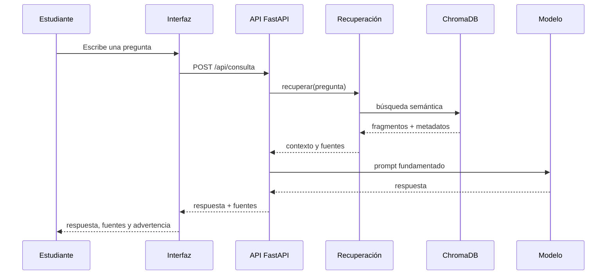

> **Objetivo de aprendizaje:** integrar interfaz, API, recuperación documental y herramientas MCP en un flujo demostrable, y validar el sistema completo con una matriz de pruebas.

## La integración no es “pegar carpetas”

Cada pieza puede funcionar por separado y aun así fallar al conectarse. La integración responde preguntas como:

- ¿La interfaz envía el JSON que la API espera?
- ¿La API encuentra la colección de ChromaDB?
- ¿La recuperación devuelve fuentes utilizables?
- ¿El modelo responde sin inventar?
- ¿Los errores se muestran de forma comprensible?
- ¿El flujo funciona en otra computadora?



## Contrato de la API

Antes de integrar, fija el contrato:

```json
{
  "pregunta": "¿Qué necesito para iniciar el servicio social?",
  "respuesta": "Para iniciar el servicio social...",
  "fuentes": [
    {
      "documento": "servicio-social.md",
      "tema": "servicio-social",
      "fragmento": "Texto recuperado..."
    }
  ],
  "advertencia": null
}
```

Errores:

```json
{
  "detail": "La pregunta no puede estar vacía"
}
```

Un contrato estable permite que la interfaz y la API evolucionen por separado.

## Backend mínimo con FastAPI

```python
from fastapi import FastAPI
from fastapi.middleware.cors import CORSMiddleware
from pydantic import BaseModel, Field

from app.rag import recuperar
from app.generacion import generar_respuesta

app = FastAPI(title="TecBot Académico")

app.add_middleware(
    CORSMiddleware,
    allow_origins=["http://localhost:5173", "http://127.0.0.1:5173"],
    allow_methods=["POST", "GET"],
    allow_headers=["Content-Type"],
)


class Consulta(BaseModel):
    pregunta: str = Field(min_length=1, max_length=1000)


@app.get("/salud")
def salud():
    return {"estado": "ok"}


@app.post("/api/consulta")
def consultar(consulta: Consulta):
    fragmentos = recuperar(consulta.pregunta, limite=4)

    if not fragmentos:
        return {
            "respuesta": "No encontré información suficiente en los documentos disponibles.",
            "fuentes": [],
            "advertencia": "Acude al departamento correspondiente para confirmar.",
        }

    respuesta = generar_respuesta(consulta.pregunta, fragmentos)

    return {
        "respuesta": respuesta,
        "fuentes": [
            {
                "documento": f["documento"],
                "tema": f["tema"],
                "fragmento": f["texto"][:300],
            }
            for f in fragmentos
        ],
        "advertencia": None,
    }
```

Ajusta CORS al puerto real de tu interfaz. No uses `allow_origins=["*"]` en una aplicación real.

## Interfaz: estados que debes manejar

Una interfaz educativa no solo necesita el caso feliz:

| Estado | Qué debe mostrar |
|---|---|
| Inicial | Campo de pregunta y ejemplos sugeridos |
| Cargando | Indicador y texto “Consultando documentos…” |
| Éxito | Respuesta, fuentes y fecha de consulta |
| Sin evidencia | Mensaje claro y recomendación de acudir al área |
| Error de red | Mensaje comprensible y botón de reintentar |
| Error del servidor | Código y opción de reportar, sin mostrar trazas internas |
| Pregunta inválida | Validación antes de enviar |

Ejemplo de llamada desde un frontend:

```javascript
async function consultar(pregunta) {
  const respuesta = await fetch(`${API_URL}/api/consulta`, {
    method: 'POST',
    headers: { 'Content-Type': 'application/json' },
    body: JSON.stringify({ pregunta }),
  })

  if (!respuesta.ok) {
    throw new Error('No fue posible obtener una respuesta. Intenta de nuevo.')
  }

  return respuesta.json()
}
```

Muestra las fuentes con nombre de documento y un fragmento corto. No ocultes la advertencia cuando no hay evidencia.

## Variables de entorno

No hardcodees rutas ni claves:

```bash
# .env.example
API_URL=http://localhost:8000
MODELO=llama3.2:3b
CHROMA_PATH=./chroma_db
```

```python
import os

MODELO = os.getenv("MODELO", "llama3.2:3b")
CHROMA_PATH = os.getenv("CHROMA_PATH", "chroma_db")
```

El archivo `.env` no se versiona. `.env.example` sí, para documentar las variables necesarias.

## Ejecutar todo localmente

Abre tres terminales o usa un solo flujo documentado:

```bash
# Terminal 1: modelo local (si aplica)
ollama serve

# Terminal 2: API
source .venv/bin/activate
uvicorn app.main:app --reload --port 8000

# Terminal 3: interfaz
npm install
npm run dev
```

Verifica primero `/salud`, luego una consulta desde la interfaz.

## Matriz de integración

| ID | Escenario | Entrada | Resultado esperado |
|---|---|---|---|
| I-01 | Servicio disponible | GET `/salud` | `{"estado":"ok"}` |
| I-02 | Consulta respondible | Pregunta de servicio social | Respuesta + fuente correcta |
| I-03 | Consulta de otro tema | Pregunta de titulación | Fuente de titulación |
| I-04 | Sin evidencia | Pregunta fuera del corpus | Advertencia y sin fuentes inventadas |
| I-05 | Pregunta vacía | `""` | 422 |
| I-06 | API caída | Interfaz sin backend | Mensaje de error comprensible |
| I-07 | Respuesta lenta | Modelo lento | Indicador de carga, sin doble envío |
| I-08 | Fuente visible | Cualquier respuesta | Documento identificable |
| I-09 | Móvil | Pantalla de 360 px | Formulario y fuentes legibles |
| I-10 | Reinicio | Cerrar y abrir la app | Índice disponible y consulta funcional |

## Errores de integración frecuentes

### CORS

Síntoma: la interfaz muestra error de red, pero la API responde en el navegador.

```text
Access to fetch at 'http://localhost:8000/api/consulta' from origin
'http://localhost:5173' has been blocked by CORS policy.
```

Solución: configura `CORSMiddleware` con el origen exacto de la interfaz.

### Ruta de la base vectorial

Síntoma: `Collection does not exist` o la API inicia pero no recupera nada.

Solución: ejecuta la API desde la raíz del proyecto o usa una ruta absoluta configurada. Reconstruye el índice si es necesario.

### Modelo no disponible

Síntoma: timeout o error de conexión al generar.

Solución: verifica `ollama serve`, el nombre del modelo y el tiempo de respuesta. Define un mensaje de fallback.

### Respuestas duplicadas por doble envío

Síntoma: dos consultas por un clic.

Solución: desactiva el botón mientras está en curso y usa una bandera de carga.

### Fuentes vacías en el caso feliz

Síntoma: la respuesta llega, pero no hay documentos.

Solución: revisa que la recuperación devuelva metadatos y que el backend los transforme correctamente. No inventes fuentes en el frontend.

## Revisión final del repositorio

```bash
git status
git diff --stat
pytest -q
```

Comprueba:

- [ ] `README.md` explica instalación, ejecución y alcance.
- [ ] `AGENTS.md` está actualizado.
- [ ] `.env` no está versionado.
- [ ] `chroma_db/` no está versionado.
- [ ] Los documentos de demostración están marcados como tales.
- [ ] Las pruebas pasan.
- [ ] La rama `main` tiene la versión demostrable.
- [ ] El repositorio tiene URL pública o accesible para el equipo.

## Actividad de práctica

1. Integra la interfaz con la API usando el contrato acordado.
2. Implementa los estados de carga, error y sin evidencia.
3. Ejecuta la matriz I-01 a I-10 y registra el resultado.
4. Pide a otra pareja que use la aplicación sin explicaciones.
5. Corrige al menos un problema de usabilidad encontrado.
6. Actualiza README, AGENTS.md y la documentación de pruebas.
7. Haz el commit final y verifica que el repositorio se puede clonar y ejecutar.

**Resultado esperado:** flujo de extremo a extremo funcional, con evidencia de pruebas y un repositorio reproducible.

## Problemas frecuentes

**“En mi máquina funciona.”**  
Documenta versiones, variables y comandos. Prueba en una carpeta limpia o en otra computadora.

**“La respuesta tarda demasiado.”**  
Mide por separado recuperación y generación. Reduce `k`, usa un modelo más pequeño o muestra un estado de carga honesto.

**“El agente agregó una dependencia que nadie conoce.”**  
Revisa `requirements.txt` y el diff. Toda dependencia debe tener justificación y una versión fijada.

**“La demo falla justo antes de presentar.”**  
Ten un plan B: capturas, un video corto o una ejecución local preparada. Nunca dependas de la red del aula.

## Recursos complementarios

- [FastAPI](https://fastapi.tiangolo.com/)
- [ChromaDB](https://docs.trychroma.com/)
- [Ollama](https://ollama.com/)
- [GitHub Docs](https://docs.github.com/)
- [Ejemplo de documentación de pruebas](/tecbot-academico/documentacion/pruebas.md)

**Siguiente paso:** preparar la [Demostración y presentación final](/dias/dia-4/presentacion).
