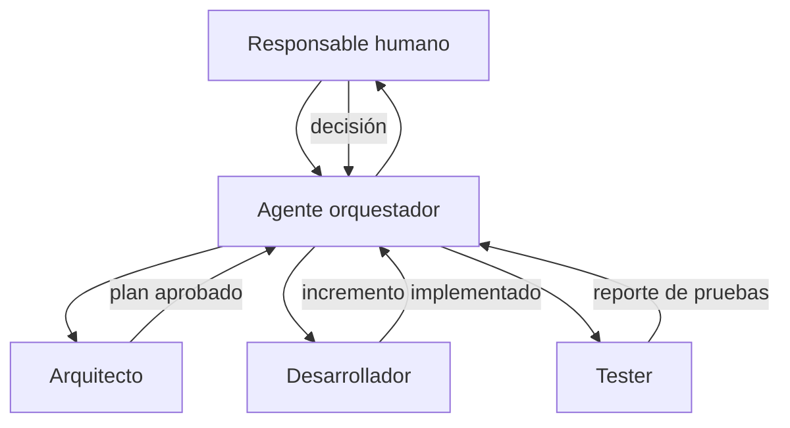

> **Objetivo de aprendizaje:** coordinar varios agentes y subagentes con tareas, dependencias, permisos y puntos de revisión humana para integrar una solución demostrable.

## Qué es orquestar agentes

Orquestar es decidir **quién hace qué, en qué orden, con qué información y cuándo se detiene**. No es lanzar cinco agentes al mismo tiempo y esperar que el resultado aparezca.

Una orquestación mínima tiene:

- Un objetivo común.
- Roles con responsabilidades distintas.
- Entradas y salidas claras.
- Dependencias entre tareas.
- Puntos de revisión.
- Criterios de terminación.
- Un responsable humano.



## Patrones de coordinación

### Secuencial

Una tarea alimenta a la siguiente. Es el patrón más fácil de controlar y el recomendado para empezar.

```text
Requerimientos → Arquitectura → Implementación → Pruebas → Documentación
```

### Supervisor

Un agente principal decide qué subagente interviene y consolida los resultados. Útil cuando hay tareas de distinto tipo y un único punto de decisión.

```text
Orquestador
├── Arquitecto: revisa diseño
├── Desarrollador: implementa
└── Tester: valida
```

### Paralelo

Varias tareas independientes se ejecutan al mismo tiempo. Solo tiene sentido si no comparten archivos ni decisiones.

```text
Documentación técnica ─┐
Pruebas de API ────────┼──> Integración
Revisión de UI ────────┘
```

Si dos agentes editan el mismo archivo en paralelo, tendrás conflictos. La paralelización requiere límites claros.

## Roles y dependencias en TecBot Académico

| Tarea | Responsable | Entrada | Salida | Depende de |
|---|---|---|---|---|
| Definir contrato de consulta | Arquitecto | Requerimientos | Esquema JSON + plan | Req. aprobados |
| Implementar recuperación | Desarrollador | Contrato + corpus | Función `recuperar()` | Contrato |
| Implementar ruta | Desarrollador | Contrato | `POST /api/consulta` | Recuperación |
| Probar recuperación | Tester | Corpus + preguntas | Reporte de casos | Recuperación |
| Validar respuesta | Tester | Ruta + documentos | Matriz de aceptación | Ruta |
| Documentar | Desarrollador | Cambios + pruebas | README actualizado | Integración |

La tabla es el contrato de la orquestación. Si una tarea no tiene entrada, salida y responsable, todavía no está lista para delegarse.

## Orquestación con OpenCode

OpenCode permite configurar subagentes y restringir qué agentes puede invocar cada uno. Un agente primario puede actuar como coordinador:

```json
{
  "$schema": "https://opencode.ai/config.json",
  "agent": {
    "coordinador": {
      "description": "Planifica, delega y consolida el trabajo del equipo.",
      "mode": "primary",
      "permission": {
        "edit": "deny",
        "bash": "deny",
        "task": {
          "*": "deny",
          "arquitecto": "allow",
          "desarrollador": "allow",
          "tester": "allow"
        }
      }
    },
    "arquitecto": {
      "description": "Diseña y revisa sin modificar archivos.",
      "mode": "subagent",
      "prompt": "{file:./prompts/arquitecto.md}",
      "permission": { "edit": "deny", "bash": "deny" }
    },
    "desarrollador": {
      "description": "Implementa cambios aprobados y ejecuta pruebas.",
      "mode": "subagent",
      "prompt": "{file:./prompts/desarrollador.md}",
      "permission": { "edit": "allow", "bash": "ask" }
    },
    "tester": {
      "description": "Ejecuta pruebas y reporta fallos sin editar código.",
      "mode": "subagent",
      "prompt": "{file:./prompts/tester.md}",
      "permission": {
        "edit": "deny",
        "bash": {
          "*": "deny",
          "pytest *": "allow",
          "python -m pytest *": "allow",
          "git diff *": "allow"
        }
      }
    }
  }
}
```

El coordinador no edita ni ejecuta comandos: solo piensa, delega y consolida. Eso reduce el riesgo de que “arregle” el trabajo de los demás.

La opción `subagent_depth` limita cuántos niveles de subagentes pueden invocarse. Para el curso, un nivel es suficiente:

```json
{
  "subagent_depth": 1
}
```

## Un flujo de trabajo orquestado

### 1. El humano define el objetivo

```text
Objetivo del día: que la consulta de servicio social funcione de extremo a extremo,
incluya fuentes y pase las pruebas de aceptación.

No modificar los documentos de demostración.
No agregar autenticación.
```

### 2. El coordinador descompone

```text
@coordinador descompón el objetivo en tareas para arquitecto, desarrollador y tester.
Incluye dependencias, archivos afectados y criterios de terminación.
No implementes nada todavía.
```

### 3. El arquitecto propone

```text
@arquitecto revisa el contrato de /api/consulta y la integración con RAG.
Señala riesgos y decide si hace falta cambiar la estructura.
```

### 4. El humano aprueba

Revisa el plan. Corrige el alcance. No delegues una decisión que no entiendes.

### 5. El desarrollador implementa por incrementos

```text
@desarrollador implementa solo el incremento 1 del plan aprobado.
Ejecuta las pruebas y muestra el diff resumido.
```

### 6. El tester valida

```text
@tester ejecuta la suite y revisa el cumplimiento de HU-01.
Reporta fallos con pasos para reproducir. No edites archivos.
```

### 7. El humano integra

Revisa el diff, ejecuta las pruebas, actualiza el contexto y hace el commit.

## Puntos de control humanos

No todo debe automatizarse. Establece checkpoints obligatorios antes de:

- Cambiar el contrato de la API.
- Modificar documentos fuente.
- Agregar una dependencia.
- Tocar configuración de permisos o MCP.
- Hacer merge a `main`.
- Publicar una demostración.

En estos puntos, el agente puede proponer, pero la decisión es humana.

## Señales de una mala orquestación

- Varios agentes editan los mismos archivos sin coordinación.
- Nadie sabe cuál es la versión buena.
- El coordinador delega tareas sin criterio de terminación.
- El tester recibe código sin pruebas ni contexto.
- Se ejecutan tareas en paralelo que dependen entre sí.
- El costo o el tiempo crece sin resultados verificables.
- El humano solo aparece al final.

## Mecanismos de parada

Define límites antes de empezar:

| Límite | Ejemplo |
|---|---|
| Tiempo | “Si en 20 minutos no hay prueba ejecutada, detente y reporta.” |
| Alcance | “Máximo tres archivos modificados en este incremento.” |
| Intentos | “Después de dos fallos de la misma prueba, no cambies más código.” |
| Costo | “No uses más de N llamadas al modelo para esta tarea.” |
| Calidad | “No se integra nada sin `pytest` en verde.” |

Un agente que falla repetidamente no necesita más instrucciones: necesita que un humano revise el problema.

## Actividad de práctica

1. Dibuja la orquestación de tu proyecto con tres roles.
2. Escribe una tabla de tareas con entrada, salida, dependencia y criterio de terminación.
3. Configura un agente coordinador con permisos de solo lectura.
4. Ejecuta una tarea pequeña de principio a fin.
5. Registra en qué punto tuviste que intervenir y por qué.
6. Ajusta los permisos o las descripciones de los agentes con base en lo observado.

**Resultado esperado:** un flujo de orquestación documentado y probado, con puntos de control humanos explícitos.

## Problemas frecuentes

**“El coordinador hace todo él mismo.”**  
No tiene subagentes disponibles, las descripciones son ambiguas o los permisos de `task` están mal configurados. Verifica con `opencode agent list` y prueba `@nombre`.

**“Dos agentes se contradicen.”**  
Falta una fuente única de verdad. Define que `AGENTS.md` y los requerimientos mandan, y que el humano resuelve conflictos.

**“El flujo nunca termina.”**  
No hay criterio de terminación ni límite de intentos. Agrega condiciones de parada medibles.

**“El costo se disparó.”**  
Se delegaron tareas triviales o se usaron modelos grandes para todo. Reserva el razonamiento costoso para decisiones y revisión.

**“El tester aprueba sin evidencia.”**  
Su prompt o sus permisos son incorrectos. Exige comandos ejecutados, salida y casos cubiertos.

## Recursos complementarios

- [OpenCode: agentes](https://opencode.ai/docs/agents/)
- [OpenCode: permisos](https://opencode.ai/docs/permissions/)
- [OpenCode: configuración](https://opencode.ai/docs/config/)
- [Prompts de ejemplo](/tecbot-academico/prompts/arquitecto.md)
- [Ejemplo de configuración](/descargas/opencode-agents.json)

**Siguiente paso:** integrar y validar el flujo completo en [Integración y validación](/dias/dia-4/integracion).
