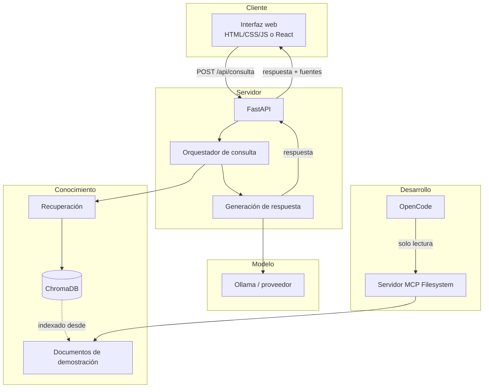
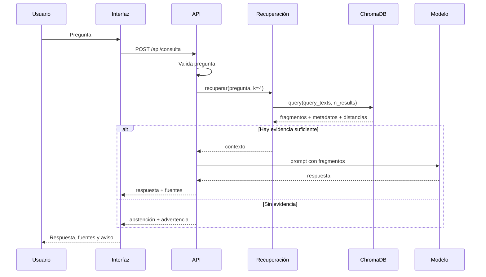
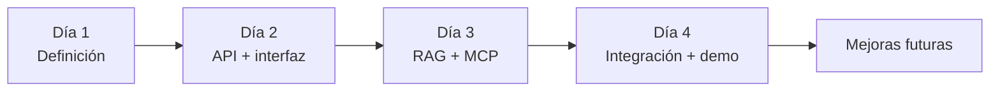

> **Aviso:** esta arquitectura corresponde a un prototipo didáctico. No describe sistemas oficiales del tecnológico ni una infraestructura de producción.

## Principios de la arquitectura

1. **Local primero:** todo debe ejecutarse en el equipo del estudiante sin servicios obligatorios de pago.
2. **Piezas reemplazables:** el modelo, la base vectorial y la interfaz pueden cambiar sin reescribir todo.
3. **Demostrable:** cada componente debe poder probarse por separado.
4. **Trazable:** las respuestas deben poder rastrearse hasta un documento.
5. **Seguro por defecto:** el acceso a archivos es restringido y de solo lectura.
6. **Suficiente, no perfecto:** priorizamos un flujo funcional sobre una arquitectura empresarial.

## Arquitectura de referencia



> **Nota:** OpenCode y MCP son herramientas del **proceso de desarrollo**, no componentes que el estudiante final necesita para usar la aplicación. La aplicación desplegada solo requiere la interfaz, la API, la base vectorial y el modelo.

## Componentes y responsabilidades

| Componente | Responsabilidad | No debe hacer |
|---|---|---|
| Interfaz | Recibir la pregunta, mostrar respuesta, fuentes y estados | Inventar fuentes ni ocultar advertencias |
| API FastAPI | Validar, orquestar, devolver el contrato | Contener reglas institucionales hardcodeadas |
| Orquestador | Decidir el flujo de recuperación y generación | Redactar la respuesta final |
| Recuperación | Buscar fragmentos relevantes y devolver metadatos | Decidir si una norma es válida |
| ChromaDB | Almacenar embeddings y metadatos | Ser la fuente de verdad editorial |
| Documentos | Ser el corpus de conocimiento | Mezclar datos reales con demo |
| Generación | Redactar una respuesta clara con base en el contexto | Agregar requisitos que no estén en los fragmentos |
| MCP Filesystem | Dar acceso controlado al agente de desarrollo | Exponer todo el disco |

## Flujo de una consulta



## Tecnologías

| Capa | Tecnología | Motivo |
|---|---|---|
| Interfaz | HTML/CSS/JS o React + Vite | Bajo costo, fácil de ejecutar y desplegar |
| API | Python + FastAPI | Tipado, validación y documentación automática |
| Servidor | Uvicorn | Servidor ASGI simple para desarrollo |
| Validación | Pydantic | Contratos claros y mensajes de error |
| Base vectorial | ChromaDB | Local, gratuita y sencilla de instalar |
| Embeddings | Modelo local de Chroma u Ollama | Sin dependencia obligatoria de una API comercial |
| Generación | Ollama o proveedor compatible | Permite ejecución local y control de costos |
| Agentes | OpenCode | Configuración de agentes, permisos y MCP |
| Herramientas | MCP Filesystem | Acceso restringido a documentos |
| Pruebas | pytest + TestClient | Pruebas de API reproducibles |
| Control de versiones | Git + GitHub | Historial, colaboración y evidencia |

## Estructura del proyecto

```text
tecbot-academico/
├── app/
│   ├── main.py
│   ├── schemas.py
│   ├── rag.py
│   ├── generation.py
│   └── config.py
├── documentos-demo/
│   ├── servicio-social.md
│   ├── residencias-profesionales.md
│   ├── titulacion.md
│   └── acreditacion-academica.md
├── documentacion/
│   ├── requerimientos.md
│   ├── arquitectura.md
│   ├── pruebas.md
│   └── evidencias/
├── prompts/
│   ├── arquitecto.md
│   ├── desarrollador.md
│   └── tester.md
├── scripts/
│   ├── indexar.py
│   └── consultar.py
├── tests/
│   ├── test_consulta.py
│   └── test_recuperacion.py
├── frontend/
├── .env.example
├── .gitignore
├── AGENTS.md
├── opencode.json
├── requirements.txt
└── README.md
```

## Contrato de la API

### `GET /salud`

```json
{ "estado": "ok" }
```

### `POST /api/consulta`

Solicitud:

```json
{
  "pregunta": "¿Qué necesito para iniciar el servicio social?"
}
```

Respuesta con evidencia:

```json
{
  "respuesta": "Para iniciar el servicio social...",
  "fuentes": [
    {
      "documento": "servicio-social.md",
      "tema": "servicio-social",
      "fragmento": "Texto recuperado..."
    }
  ],
  "advertencia": null
}
```

Respuesta sin evidencia:

```json
{
  "respuesta": "No encontré información suficiente en los documentos disponibles.",
  "fuentes": [],
  "advertencia": "Acude al departamento correspondiente para confirmar."
}
```

Error de validación:

```json
{
  "detail": [
    {
      "type": "string_too_short",
      "loc": ["body", "pregunta"],
      "msg": "String should have at least 1 character"
    }
  ]
}
```

## Configuración de OpenCode

`opencode.json` en la raíz del proyecto:

```json
{
  "$schema": "https://opencode.ai/config.json",
  "instructions": ["AGENTS.md"],
  "permission": {
    "edit": "ask",
    "bash": "ask"
  },
  "agent": {
    "arquitecto": {
      "description": "Analiza el proyecto y propone arquitectura sin modificar archivos.",
      "mode": "subagent",
      "prompt": "{file:./prompts/arquitecto.md}",
      "temperature": 0.1,
      "permission": { "edit": "deny", "bash": "deny", "webfetch": "deny" }
    },
    "disenador-web": {
      "description": "Define la interfaz, componentes y sistema de diseño. No implementa lógica.",
      "mode": "subagent",
      "prompt": "{file:./prompts/disenador-web.md}",
      "temperature": 0.2,
      "permission": { "edit": "deny", "bash": "deny" }
    },
    "desarrollador": {
      "description": "Implementa funcionalidades aprobadas y escribe pruebas.",
      "mode": "subagent",
      "prompt": "{file:./prompts/desarrollador.md}",
      "permission": { "edit": "allow", "bash": "ask" }
    },
    "tester": {
      "description": "Ejecuta pruebas y reporta fallos sin modificar el código.",
      "mode": "subagent",
      "prompt": "{file:./prompts/tester.md}",
      "temperature": 0.1,
      "permission": {
        "edit": "deny",
        "bash": {
          "*": "deny",
          "pytest *": "allow",
          "python -m pytest *": "allow",
          "git diff *": "allow",
          "git status *": "allow"
        }
      }
    }
  },
  "mcp": {
    "documentos_academicos": {
      "type": "local",
      "command": [
        "npx",
        "-y",
        "@modelcontextprotocol/server-filesystem",
        "RUTA_ABSOLUTA/documentos-demo"
      ],
      "enabled": true
    }
  }
}
```

Sustituye `RUTA_ABSOLUTA` por la ruta real. No la dejes como texto de ejemplo.

## Decisiones de arquitectura

### ¿Por qué FastAPI?

- Validación con Pydantic.
- Documentación interactiva en `/docs`.
- Bajo costo de configuración.
- Fácil de probar con `TestClient`.

### ¿Por qué ChromaDB?

- Se ejecuta localmente.
- Persistencia simple.
- API de colecciones y metadatos adecuada para el curso.
- No requiere un servidor externo ni credenciales.

### ¿Por qué no una base de datos relacional?

El prototipo no gestiona usuarios, trámites ni transacciones. Una base relacional agregaría complejidad sin aportar al objetivo de aprendizaje.

### ¿Por qué RAG y no fine-tuning?

RAG permite actualizar el conocimiento sin reentrenar, citar fuentes y mantener el corpus separado. Fine-tuning no es necesario para este alcance y requiere más datos y cómputo.

### ¿Por qué MCP solo en desarrollo?

La aplicación final no necesita que el agente de OpenCode consulte archivos en tiempo de ejecución. El backend usa su propio acceso controlado al corpus. MCP se usa para enseñar cómo un agente interactúa con herramientas externas.

### ¿Por qué documentos de demostración?

Porque no se deben inventar requisitos institucionales reales. Los documentos ficticios permiten practicar el flujo y se marcan como material didáctico.

## Seguridad

- No se procesan datos personales.
- `.env` fuera de Git.
- CORS restringido a la interfaz local.
- MCP apunta solo a `documentos-demo/`.
- Escritura MCP denegada.
- Validación de entrada en la API.
- Límite de longitud de pregunta.
- Mensajes de error sin trazas internas.
- Dependencias con versiones fijadas.
- Corpus marcado como demostración.

## Estrategia de pruebas

| Nivel | Herramienta | Ejemplo |
|---|---|---|
| Unidad | pytest | Normalización, fragmentación, recuperación |
| Integración | pytest + TestClient | Ruta + recuperación + formato |
| Contrato | TestClient | 200, 422 y estructura JSON |
| Manual | Navegador | Casos de la matriz de aceptación |
| Seguridad | Prueba MCP | Acceso fuera de la carpeta y escritura |

## Evolución prevista



Mejoras futuras posibles:

- Evaluación automatizada de fidelidad.
- Reranking de fragmentos.
- Historial persistente.
- Panel de documentos.
- Métricas de consultas sin respuesta.
- Despliegue con un corpus validado.

## Relación con el portal del curso

El portal es un sitio estático separado. **No implementa** la API, la base vectorial ni el servidor MCP. Su función es documentar y guiar el aprendizaje. TecBot Académico se desarrolla en su propio repositorio.

## Documentos relacionados

- [Descripción](/proyecto-conductor/descripcion)
- [Requerimientos](/proyecto-conductor/requerimientos)
- [RAG](/proyecto-conductor/rag)
- [MCP](/proyecto-conductor/mcp)
- [Configuración de ejemplo](/descargas/opencode-agents.json)
- [Arquitectura Mermaid descargable](/descargas/arquitectura.mmd)
