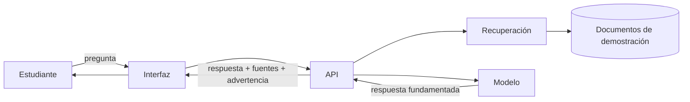

> **Aviso:** este proyecto es un caso didáctico del curso. Los documentos incluidos son ficticios, están marcados como material de demostración y **no representan normativa oficial** del Instituto Tecnológico Superior de Santiago Papasquiaro. En un despliegue real deben sustituirse por información validada por el área responsable.

## El problema

Los estudiantes de una institución de educación superior necesitan resolver dudas sobre procesos académicos y administrativos: servicio social, residencias profesionales, titulación, acreditación de asignaturas y trámites escolares.

La información suele estar disponible, pero:

- Está distribuida en varios documentos y formatos.
- No siempre se sabe qué documento está vigente.
- Las preguntas se repiten en ventanilla.
- Una respuesta sin fuente es difícil de verificar.
- Los estudiantes usan lenguaje cotidiano, no terminología administrativa.

El problema no es la falta de información en abstracto, sino la **dificultad de encontrar la información correcta en el momento en que se necesita y con evidencia de su origen**.

## La propuesta

**TecBot Académico** es un asistente conversacional que responde preguntas de información académica usando un corpus documental controlado.

Características:

- Recibe preguntas en lenguaje natural.
- Identifica el tema de la consulta.
- Recupera fragmentos de documentos relevantes.
- Genera una respuesta breve y clara.
- Muestra los documentos utilizados.
- Reconoce cuando no tiene evidencia suficiente.
- Deriva al departamento correspondiente.
- No inventa requisitos, fechas, montos ni procedimientos.

## Justificación

### Valor para el estudiante

- Encuentra orientación sin conocer la estructura administrativa.
- Puede verificar la fuente antes de actuar.
- Recibe una respuesta inmediata para dudas frecuentes.
- Sabe a qué área acudir cuando el asistente no puede responder.

### Valor para el área académica

- Reduce consultas repetitivas de información ya documentada.
- Mantiene un discurso consistente si el corpus está validado.
- Permite identificar preguntas frecuentes que no están cubiertas.
- Deja trazabilidad de las fuentes utilizadas.

### Valor para el curso

- Integra definición de problema, requerimientos, agentes, RAG y MCP.
- Permite construir de forma incremental en 15 horas.
- Tiene un alcance demostrable sin depender de sistemas institucionales reales.
- Obliga a distinguir entre información oficial y orientación general.

## Objetivo general

Diseñar y construir un prototipo de asistente conversacional que responda preguntas de información académica con base en documentos de demostración, cite sus fuentes y reconozca sus límites.

## Objetivos específicos

1. Definir el problema, los usuarios y el alcance del asistente.
2. Traducir las necesidades en requerimientos e historias de usuario verificables.
3. Construir una interfaz web para formular y leer consultas.
4. Implementar una API que reciba preguntas y devuelva respuestas con fuentes.
5. Preparar un corpus documental de demostración y fragmentarlo.
6. Indexar los fragmentos en una base vectorial local.
7. Recuperar evidencia y generar respuestas fundamentadas.
8. Configurar un servidor MCP Filesystem con acceso restringido.
9. Validar el flujo con pruebas automatizadas y manuales.
10. Documentar el proceso y demostrar el prototipo.

## Usuarios

| Usuario | Necesidad | Uso esperado |
|---|---|---|
| Estudiante de nuevo ingreso | Orientación sobre trámites y servicios | Consultas frecuentes |
| Estudiante de semestres avanzados | Servicio social, residencias y titulación | Consultas previas a un trámite |
| Egresado | Modalidades y requisitos de titulación | Consulta de etapas y documentos |
| Personal de apoyo | Canalizar dudas | Derivación y consulta de respaldo |
| Docente | Orientar sin improvisar | Referencia a fuentes |
| Equipo del curso | Aprender el flujo completo | Desarrollo y validación |

## Alcance

### Incluye

- Consultas en español sobre los cinco temas del corpus.
- Respuestas fundamentadas con citas.
- Visualización de fuentes.
- Mensaje de abstención cuando no hay evidencia.
- Corpus de cuatro documentos ficticios.
- Base vectorial local.
- Servidor MCP de solo lectura para el agente de desarrollo.
- Pruebas de API y casos manuales.
- Documentación reproducible.

### No incluye

- Autenticación o cuentas de usuario.
- Datos personales de estudiantes.
- Trámites oficiales, firmas o pagos.
- Integración con sistemas institucionales reales.
- Base de datos de producción.
- Despliegue público con documentos reales.
- Asesoría legal o normativa.
- Notificaciones o correo.
- Panel administrativo.

> **Decisión de alcance:** el prototipo demuestra el flujo técnico y la experiencia de consulta. No se presenta como un servicio oficial.

## Principios de diseño

1. **Fundamentación:** responder con base en fragmentos recuperados.
2. **Trazabilidad:** mostrar el documento de origen.
3. **Abstención:** decir “no encontré información suficiente” cuando corresponda.
4. **Mínimo privilegio:** el agente accede solo a la carpeta de documentos.
5. **Separación de responsabilidades:** la recuperación no redacta; el modelo no decide la norma.
6. **Transparencia:** marcar los documentos como demostración.
7. **Reproducibilidad:** otra persona puede ejecutar el proyecto con instrucciones claras.

## Preguntas que debe resolver

### Servicio social

- ¿Cuáles son los requisitos para iniciar el servicio social?
- ¿Qué documentación debo entregar?
- ¿Cómo se realiza el registro?
- ¿Cómo se reportan las actividades?
- ¿Qué necesito para solicitar la liberación?

### Residencias profesionales

- ¿Cuándo puedo iniciar las residencias?
- ¿Cuáles son los requisitos?
- ¿Cómo se registra el proyecto?
- ¿Qué documentos debo presentar?
- ¿Cómo se realizan los reportes?
- ¿Cómo se concluye el proceso?

### Titulación

- ¿Cuáles son las modalidades disponibles?
- ¿Qué requisitos debo cumplir?
- ¿Qué documentos necesito?
- ¿Cómo inicio el trámite?
- ¿Qué etapas tiene el proceso?
- ¿Dónde puedo consultar los formatos?

### Acreditación académica

- ¿Cómo puedo acreditar una asignatura?
- ¿Qué sucede si repruebo una materia?
- ¿Qué requisitos existen para acreditar actividades complementarias?
- ¿Cómo se registran y validan los créditos?
- ¿Qué procedimientos existen para regularizar mi situación?

### Trámites generales

- Calendario escolar.
- Reinscripciones.
- Constancias.
- Reglamentos.
- Solicitudes escolares.

## Métricas de éxito del prototipo

| Métrica | Objetivo inicial |
|---|---|
| Consultas respondidas con al menos una fuente | ≥ 90% de casos del conjunto de evaluación |
| Casos sin evidencia que no inventan fuentes | 100% |
| Tiempo de respuesta en el equipo de demo | ≤ 12 segundos |
| Pruebas automatizadas en verde | 100% de la suite definida |
| Preguntas de evaluación con documento correcto en top-3 | ≥ 80% |
| Personas que entienden la advertencia de demostración | 100% en prueba con usuarias y usuarios |

Estas métricas son del prototipo, no de un servicio institucional.

## Riesgos y mitigaciones

| Riesgo | Impacto | Mitigación |
|---|---|---|
| El modelo inventa requisitos | Alto | Prompt restrictivo, citas y pruebas de abstención |
| Documentos desactualizados | Alto | Marcar versión y fecha; validación del área |
| Corpus insuficiente | Medio | Medir cobertura y registrar preguntas sin respuesta |
| Recuperación irrelevante | Medio | Ajustar fragmentos, `k` y umbrales |
| Exposición de archivos | Alto | MCP restringido y permisos de solo lectura |
| Dependencia de un modelo local | Medio | Documentar alternativa y plan de contingencia |
| Confusión con información oficial | Alto | Aviso visible en documentos, interfaz y demo |

## Relación con el portal del curso

El portal que estás consultando es un **sitio estático** de contenidos. TecBot Académico es el **proyecto conductor** que se construye en las prácticas. Son proyectos separados:

| Portal del curso | TecBot Académico |
|---|---|
| Sitio estático en React/Vite | Aplicación con API y recuperación |
| Publicado en GitHub Pages | Se ejecuta localmente |
| No tiene backend | Usa FastAPI y ChromaDB |
| Organiza el aprendizaje | Es el objeto del aprendizaje |

No mezcles la interfaz del asistente dentro de la navegación del portal. El portal documenta; TecBot se construye aparte.

## Documentación relacionada

- [Requerimientos e historias de usuario](/proyecto-conductor/requerimientos)
- [Arquitectura y tecnologías](/proyecto-conductor/arquitectura)
- [Preparación de documentos para RAG](/proyecto-conductor/rag)
- [Integración MCP](/proyecto-conductor/mcp)
- [Documentos de demostración](/tecbot-academico/documentos-demo/servicio-social.md)
- [Proyecto integrador](/proyecto-integrador)
