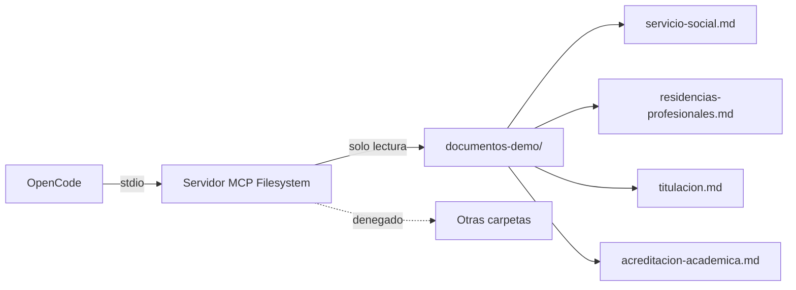

> **Aviso:** la integración MCP es una práctica didáctica. El servidor solo debe acceder a documentos ficticios de demostración. No conectes carpetas con información personal o institucional real durante el curso.

## Para qué usamos MCP en TecBot

MCP permite que el agente de desarrollo consulte los documentos del proyecto mediante herramientas, en lugar de que el usuario pegue el contenido en el chat.

En el curso cumple tres objetivos:

1. Demostrar cómo un agente descubre y usa herramientas.
2. Practicar permisos y acceso restringido.
3. Separar el acceso a documentos de la lógica del asistente.



## Alcance

### Incluye

- Servidor local por `stdio`.
- Acceso de solo lectura a `documentos-demo/`.
- Consulta de archivos desde OpenCode.
- Permisos explícitos para escritura denegada.
- Pruebas de alcance y de escritura.

### No incluye

- Exponer el servidor en internet.
- Conectar la carpeta personal del usuario.
- Permitir escritura sobre documentos.
- Usar MCP desde la interfaz del estudiante.
- Acceder a bases de datos institucionales.

## Configuración

`opencode.json`:

```json
{
  "$schema": "https://opencode.ai/config.json",
  "mcp": {
    "documentos_academicos": {
      "type": "local",
      "command": [
        "npx",
        "-y",
        "@modelcontextprotocol/server-filesystem",
        "C:\\proyectos\\tecbot-academico\\documentos-demo"
      ],
      "enabled": true,
      "timeout": 30000
    }
  },
  "permission": {
    "documentos_academicos_read_file": "ask",
    "documentos_academicos_list_directory": "allow",
    "documentos_academicos_search_files": "allow",
    "documentos_academicos_write_file": "deny",
    "documentos_academicos_edit_file": "deny",
    "documentos_academicos_create_directory": "deny",
    "documentos_academicos_move_file": "deny"
  }
}
```

Ajusta la ruta y los nombres de herramientas según tu sistema y versión del servidor.

### Windows

Si `npx` no inicia desde OpenCode, usa:

```json
"command": [
  "cmd",
  "/c",
  "npx",
  "-y",
  "@modelcontextprotocol/server-filesystem",
  "C:\\proyectos\\tecbot-academico\\documentos-demo"
]
```

### macOS y Linux

```json
"command": [
  "npx",
  "-y",
  "@modelcontextprotocol/server-filesystem",
  "/home/tu-usuario/tecbot-academico/documentos-demo"
]
```

## Herramientas esperadas

El servidor Filesystem suele exponer herramientas para:

- Listar un directorio.
- Leer uno o varios archivos.
- Buscar archivos.
- Obtener información de un archivo.
- Listar directorios permitidos.
- Escribir, editar, mover o crear directorios (que denegaremos).

Los nombres exactos pueden variar. Verifícalos antes de escribir reglas de permisos.

## Verificación

### 1. Listar servidores

```bash
opencode mcp list
```

Debe aparecer `documentos_academicos`.

### 2. Listar herramientas

Dentro de OpenCode:

```text
Lista las herramientas MCP disponibles y su propósito.
No ejecutes ninguna.
```

### 3. Probar lectura

```text
Lee documentos-demo/titulacion.md y resume sus secciones.
```

### 4. Probar alcance

```text
Intenta leer C:\Windows\System32\drivers\etc\hosts.
```

Resultado esperado: rechazo por ruta fuera del directorio permitido.

### 5. Probar escritura

```text
Crea un archivo de prueba dentro de documentos-demo/.
```

Resultado esperado: operación denegada.

### 6. Deshabilitar

```json
"enabled": false
```

Confirma que las herramientas dejan de aparecer.

## Matriz de pruebas MCP

| ID | Caso | Resultado esperado |
|---|---|---|
| MCP-01 | Listar `documentos-demo/` | Cuatro archivos `.md` |
| MCP-02 | Leer `servicio-social.md` | Contenido del documento |
| MCP-03 | Leer un archivo fuera de la carpeta | Rechazo |
| MCP-04 | Escribir en la carpeta | Denegado |
| MCP-05 | Mover un archivo | Denegado |
| MCP-06 | Deshabilitar el servidor | Herramientas ausentes |
| MCP-07 | Ruta inexistente | Error claro, sin acceso alternativo |
| MCP-08 | Solicitud de listar todo el disco | Rechazo |

Documenta la salida real en `documentacion/pruebas.md`.

## Seguridad

### Principios

- **Mínimo privilegio:** una carpeta, solo lectura.
- **Defensa en profundidad:** permisos de OpenCode + restricciones del servidor + permisos del sistema operativo.
- **Trazabilidad:** saber qué herramienta se ejecutó y con qué argumentos.
- **Revisión humana:** aprobar lecturas cuando corresponda.
- **Revocación:** poder deshabilitar el servidor en un paso.

### Nunca

- Apuntar a `C:\`, `/`, el escritorio o la carpeta del usuario.
- Incluir documentos con datos personales.
- Permitir escritura sin una razón concreta.
- Exponer el servidor en una red pública.
- Guardar tokens en `opencode.json`.
- Asumir que el prompt es un control de seguridad.

## Relación con RAG

| Necesidad | Mecanismo |
|---|---|
| El agente de desarrollo consulta documentos | MCP Filesystem |
| La aplicación responde a estudiantes | RAG con ChromaDB |
| El agente busca patrones en el código | Herramientas de búsqueda de OpenCode |
| El estudiante consulta la documentación del curso | Portal estático |

No conectes MCP directamente al frontend. Si la aplicación necesita archivos, el backend debe implementar su propia capa de acceso validada.

## Limitaciones del prototipo

- El servidor se ejecuta localmente; no es un servicio compartido.
- No hay autenticación de usuarios.
- Los documentos son ficticios.
- Los permisos dependen de la versión de OpenCode y del servidor.
- No se auditan llamadas en una base de datos.
- No hay cuotas ni límites de uso más allá del timeout.

## Checklist de integración

- [ ] La ruta apunta solo a `documentos-demo/`.
- [ ] El servidor inicia y aparece en `opencode mcp list`.
- [ ] Las herramientas fueron identificadas.
- [ ] La lectura requiere aprobación.
- [ ] La escritura está denegada.
- [ ] La prueba fuera de alcance fue rechazada.
- [ ] La prueba de escritura fue rechazada.
- [ ] El servidor se puede deshabilitar.
- [ ] La configuración está versionada.
- [ ] Los resultados están documentados.

## Documentos relacionados

- [Fundamentos de MCP](/dias/dia-3/fundamentos-mcp)
- [MCP Filesystem paso a paso](/dias/dia-3/filesystem)
- [Configuración MCP descargable](/descargas/configuracion-mcp.json)
- [OpenCode: servidores MCP](https://opencode.ai/docs/mcp-servers/)
- [Model Context Protocol](https://modelcontextprotocol.io/)
