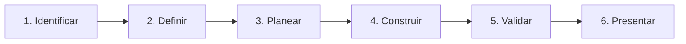

# Del problema a una solución inteligente

> **Proyecto integrador del curso**  
> Trabajo en equipos · Desarrollo de un MVP · Demostración final

## La consigna

Cada equipo elegirá uno de los proyectos propuestos en [Propuestas de proyectos integradores](/descargas/proyectos-integradores.md) y desarrollará un MVP funcional utilizando OpenCode y agentes de IA.

El proyecto debe demostrar el uso de:

- Definición del problema.
- Requerimientos y planeación.
- Contexto del proyecto mediante `AGENTS.md`.
- Delegación de tareas a agentes o subagentes.
- Desarrollo funcional o prototipo demostrable.
- Validación con pruebas.
- Control de versiones en GitHub.
- Presentación y demostración.

No se trata de calificar la cantidad de código ni la sofisticación de la IA. Se trata de construir un MVP funcional y demostrar el proceso de desarrollo con agentes.

## Equipos

El grupo de 30 estudiantes se organiza en ocho equipos:

- Seis equipos de cuatro integrantes.
- Dos equipos de tres integrantes.

Cada equipo desarrolla un proyecto diferente, elegido de las [propuestas de proyectos integradores](/descargas/proyectos-integradores.md). No se repiten propuestas.

- Cada equipo define roles, pero todos deben poder explicar el proyecto.
- Se recomienda que al menos una persona opere la demo y otra responda preguntas.
- El repositorio debe identificar a los integrantes en el README.

## Fases del proyecto

### Fase 1. Identificar la necesidad

- ¿Quién tiene el problema?
- ¿Qué hace hoy para resolverlo?
- ¿Qué le cuesta o le impide hacerlo?
- ¿Qué evidencia tienes de que el problema existe?
- ¿Qué pasa si no se resuelve?

Evita partir de una tecnología (“queremos usar IA”) y busca primero una necesidad.

### Fase 2. Definir el alcance

- Usuarios principales.
- Problema en una frase.
- Solución propuesta.
- Qué incluye y qué no.
- Supuestos y riesgos.
- Criterios de éxito.

Un alcance pequeño y terminado vale más que una idea grande a medias.

### Fase 3. Planear

- Requerimientos funcionales y no funcionales.
- Historias de usuario.
- Criterios de aceptación.
- Arquitectura inicial.
- Roles de agentes y subagentes.
- Plan de pruebas.

### Fase 4. Construir

- Configurar el repositorio.
- Crear `AGENTS.md`.
- Implementar por incrementos.
- Revisar diffs.
- Registrar commits.
- Documentar decisiones.

### Fase 5. Validar

- Ejecutar pruebas automatizadas.
- Completar una matriz manual.
- Probar el caso feliz y el caso de error.
- Revisar accesibilidad y responsive.
- Verificar que otra persona puede ejecutar el proyecto.

### Fase 6. Presentar

- Preparar un guion de 8 minutos.
- Ensayar con cronómetro.
- Preparar evidencia y plan de contingencia.
- Demostrar el flujo principal.
- Explicar el proceso con agentes.

## Entregables

| Entregable | Contenido mínimo | Evidencia |
|---|---|---|
| Definición del problema | Usuario, necesidad, alcance, justificación | Documento en el repositorio |
| Requerimientos | RF, RNF, historias y criterios | `documentacion/requerimientos.md` |
| Repositorio | Código, README, `.gitignore`, historial | URL de GitHub |
| Aplicación | Flujo funcional o prototipo demostrable | Demo en vivo o video |
| Contexto de agentes | `AGENTS.md` y configuración | Archivos versionados |
| Subagentes | Al menos dos roles probados | Configuración y capturas |
| Pruebas | Automatizadas y manuales | Salida de comandos y matriz |
| Presentación | Diapositivas y guion | Archivo o enlace |

## Objetivo de la demostración

No hay calificación numérica: el propósito es que cada equipo organice su trabajo, desarrolle su MVP y demuestre su funcionamiento. La presentación sirve para compartir el proceso, los resultados y los aprendizajes.

## Criterios de presentación

Duración sugerida: **8 minutos + 3 minutos de preguntas**.

| Bloque | Tiempo | Contenido |
|---|---|---|
| Problema | 1 min | Usuario, necesidad, consecuencia |
| Solución | 1 min | Qué hace, alcance, qué no hace |
| Demo | 3 min | Caso feliz y caso sin evidencia |
| Arquitectura | 1 min | Diagrama simple |
| Proceso con agentes | 1 min | Plan, subagentes, revisión, pruebas |
| Cierre | 1 min | Resultados, límites y aprendizajes |

Requisitos:

- Todos los integrantes deben participar.
- La demo debe funcionar o tener un plan B documentado.
- Debe mostrarse evidencia del uso de agentes.
- Debe explicarse al menos una decisión técnica.
- Debe reconocerse al menos una limitación.

## Recomendaciones

1. **Reduce el alcance.** Elige un flujo principal y hazlo bien.
2. **Define criterios antes de programar.** Sin criterios no hay forma de saber si terminaste.
3. **Documenta mientras construyes.** No dejes la documentación para el final.
4. **Haz commits pequeños.** Un historial legible es evidencia.
5. **Prueba con alguien externo.** Observa dónde se pierde.
6. **Prepara la demo sin internet.** Ten capturas o un video.
7. **No presentes lo que no entiendes.** Pregunta, revisa y corrige.
8. **Sé honesto con los límites.** Un prototipo claro vale más que una promesa grandiosa.

## Uso responsable de agentes

- Declara qué herramientas usaste.
- No ocultes que el código fue generado o asistido.
- Revisa y comprende los cambios.
- No incluyas datos personales ni secretos.
- Respeta licencias y cita fuentes.
- No uses agentes para suplantar la evaluación de otra persona.
- El equipo es responsable del resultado final.

## Lista de verificación final

### Problema y planeación

- [ ] El problema está escrito en una frase.
- [ ] El usuario principal está identificado.
- [ ] El alcance incluye y excluye explícitamente.
- [ ] Hay requerimientos funcionales y no funcionales.
- [ ] Hay historias con criterios de aceptación.
- [ ] La arquitectura está documentada.

### Desarrollo

- [ ] El flujo principal funciona.
- [ ] La interfaz maneja carga, error y éxito.
- [ ] La API valida entradas.
- [ ] Las respuestas o resultados son comprensibles.
- [ ] El proyecto se ejecuta con las instrucciones del README.

### Agentes

- [ ] `AGENTS.md` está actualizado.
- [ ] Al menos dos subagentes están configurados.
- [ ] Los permisos son coherentes con los roles.
- [ ] Hay evidencia de planificación y revisión.
- [ ] El equipo puede explicar qué hizo el agente y qué hizo el equipo.

### Repositorio

- [ ] El repositorio tiene URL accesible.
- [ ] El historial tiene commits claros.
- [ ] No hay secretos ni `.env`.
- [ ] No se versionó la base vectorial ni `node_modules`.
- [ ] El README incluye instalación, ejecución y alcance.

### Presentación

- [ ] El guion cabe en 8 minutos.
- [ ] La demo fue ensayada.
- [ ] Hay plan de contingencia.
- [ ] Las diapositivas tienen una idea por pantalla.
- [ ] Todos los integrantes participan.
- [ ] Las preguntas se responden con evidencia.

## Preguntas para la reflexión final

- ¿Qué decisión tomó el equipo sin el agente?
- ¿En qué tarea el agente fue más útil?
- ¿Dónde fue necesario intervenir?
- ¿Qué evidencia demuestra que la solución funciona?
- ¿Qué cambiarían si tuvieran otro día?
- ¿Qué parte del proceso no volverían a hacer igual?

## Recursos relacionados

- [Programa general](/programa)
- [Proyecto conductor](/proyecto-conductor)
- [Presentación final](/dias/dia-4/presentacion)
- [Recursos y plantillas](/recursos)
- [Propuestas de proyectos integradores](/descargas/proyectos-integradores.md)
